# GEBAN

**ERP de gestão empresarial completo, com fiscal, financeiro, contábil, estoque e loja, para várias empresas em uma única instalação.**

Escrito em AdvPL/TLPP, roda no runtime advplc sobre PostgreSQL. Cada empresa tem seu próprio schema de dados. O acesso é controlado por usuário, empresa, filial e módulo, com regras claras e trilha de auditoria.

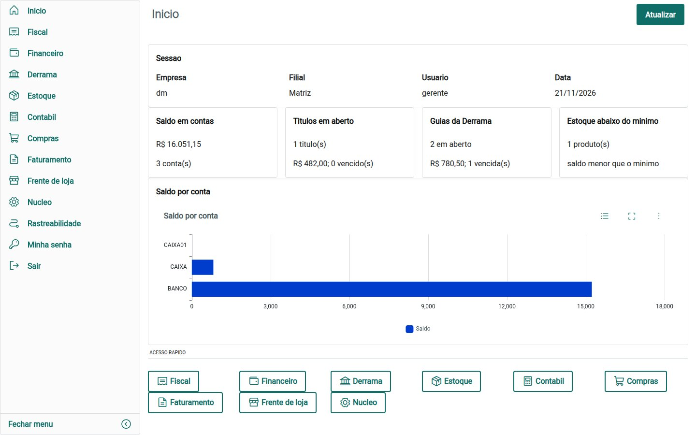

---

## Por que o GEBAN

- **Várias empresas, uma instalação.** Dados isolados por schema, um login, filiais e unidades organizadas.
- **Fiscal de ponta a ponta.** NF-e, NFC-e, NFS-e no padrão nacional, CC-e, DANFE, EFD ICMS/IPI, recebimento de notas de fornecedores e IBS/CBS.
- **Acesso que se controla.** Perfil por empresa, permissão por módulo, bloqueio e validade de usuário, troca obrigatória de senha, expiração e contas de serviço.
- **Rotinas que rodam sozinhas.** Agendador por empresa, com histórico de cada execução.
- **Operação segura.** Deploy com testes obrigatórios, backup antes de cada publicação e reversão automática se algo falhar.

---

## Módulos

| Módulo | O que resolve |
|--------|---------------|
| **Núcleo** | Empresas, unidades, filiais, usuários, vínculos, permissões, ciclo de vida do usuário e agendamentos |
| **Fiscal** | Documentos eletrônicos, produtos e NCM, apuração, EFD, DF-e de fornecedores, IBS/CBS e Lei 12.741 |
| **Simples Nacional** | Apuração mensal, faixas, Fator R, DAS e vencimentos |
| **Financeiro** | Títulos, baixas, fluxo de caixa, aging, boletos e CNAB, TEF |
| **Contábil** | Plano de contas, lançamento padrão, razão, balancete e DRE |
| **Estoque e compras** | Custo médio, kardex, lotes e séries, solicitação, pedido e recebimento |
| **Faturamento e loja** | Pedidos, notas, devoluções, frente de loja com caixa, balança e promoções |
| **Derrama** | Tributos com título no financeiro e retenções |

---

## Telas

Interface web em componentes PO-UI (`advplc serve src/GEBTUI.prw`): menu lateral com os módulos permitidos, tabelas ao vivo em abas e cada operação num formulário de tela única. Dados das imagens: empresa de demonstração fictícia.

| | |
|---|---|
| 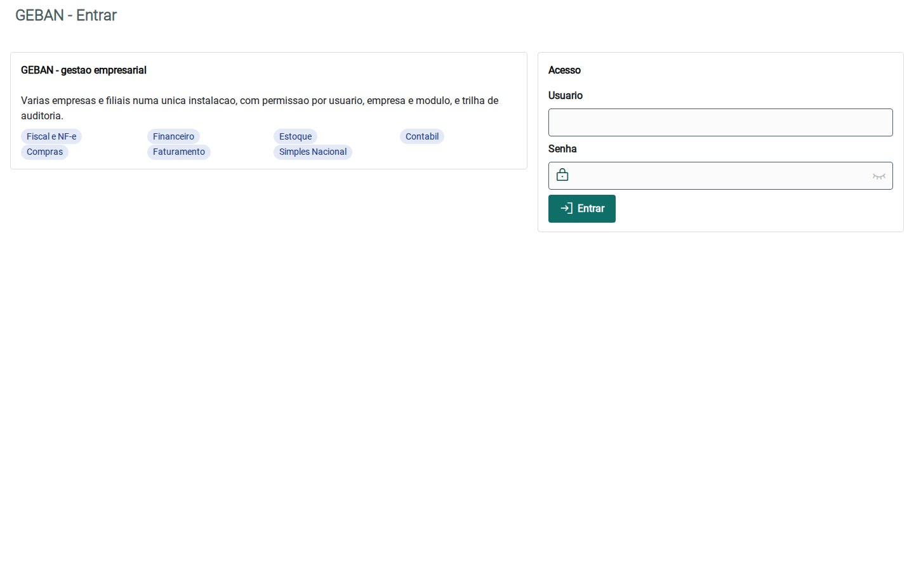 **Login** — instalação nova já traz a conta `super`; o primeiro acesso pede troca de senha | 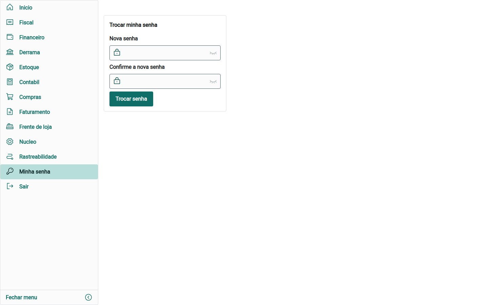 **Troca de senha obrigatória**, com as regras da política ao lado |
|  **Início** — sessão, indicadores e saldo por conta | 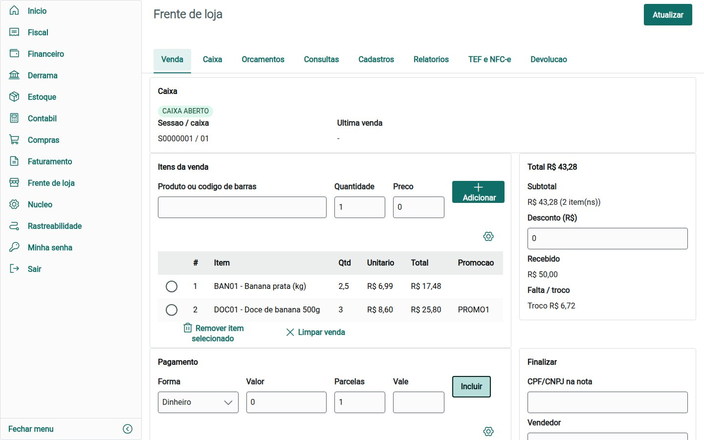 **Frente de loja** — venda numa tela: carrinho com preço e promoção, pagamentos e troco |
| 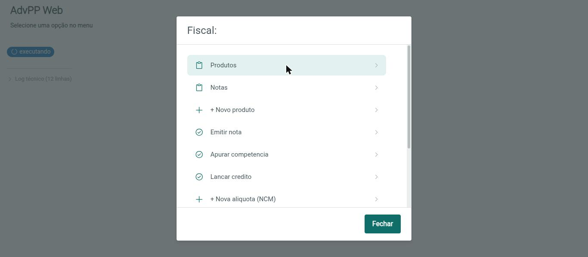 **Fiscal** — produtos, notas e Simples em abas; operações em formulários | 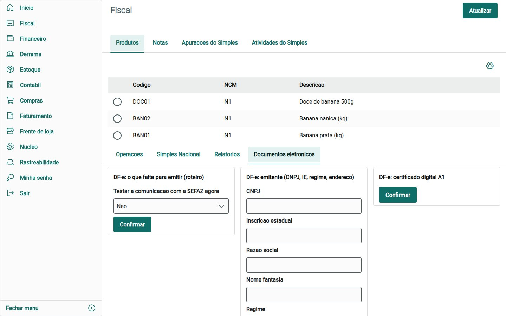 **Documentos eletrônicos** — emitente, configuração, SEFAZ, NFS-e e EFD |
| 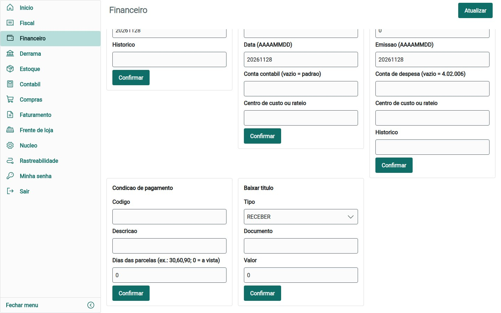 **Financeiro** — contas, títulos, baixa com juros e banco | 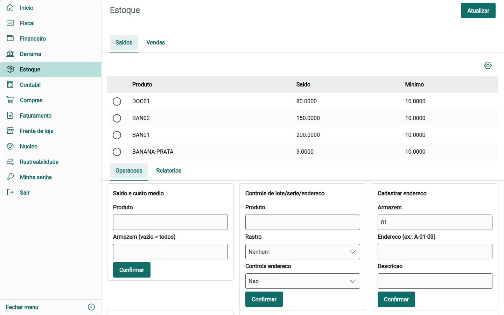 **Estoque** — saldos, lotes e endereços, fechamento do mês |
| 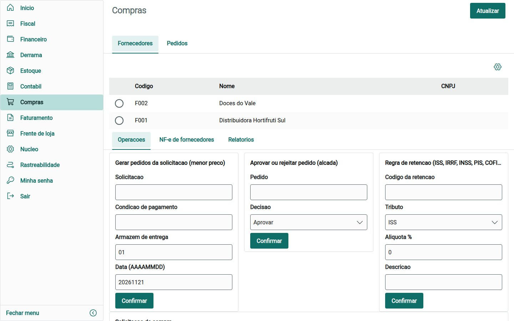 **Compras** — fornecedores, pedidos, NF-e de fornecedores | 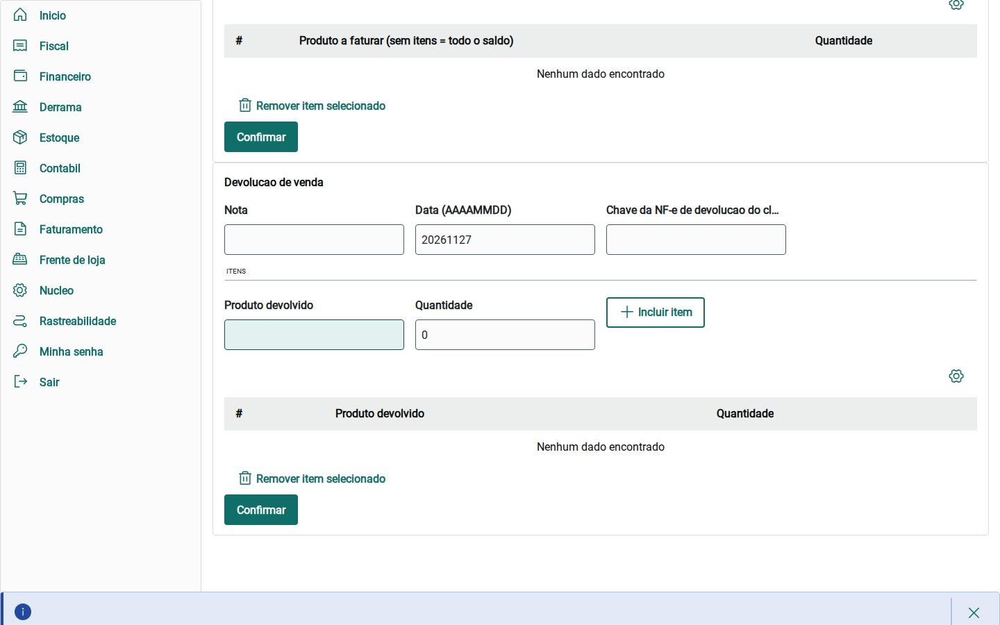 **Formulário com grade de itens** (pedido de compra) |
| 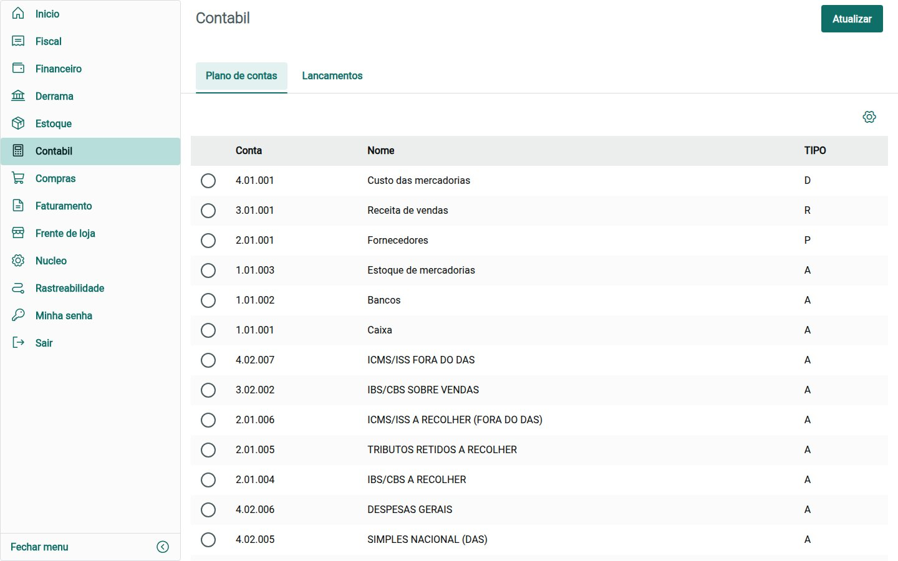 **Contábil** — plano, lançamentos, centros de custo, balancete e DRE | 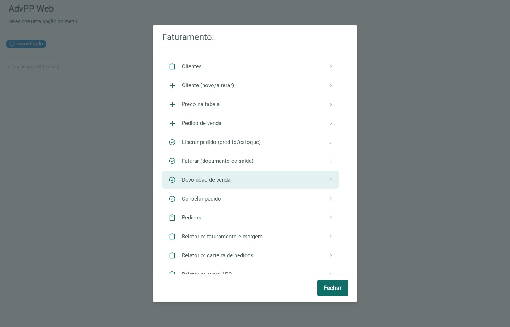 **Faturamento** — clientes, pedidos, faturamento e devolução |
| 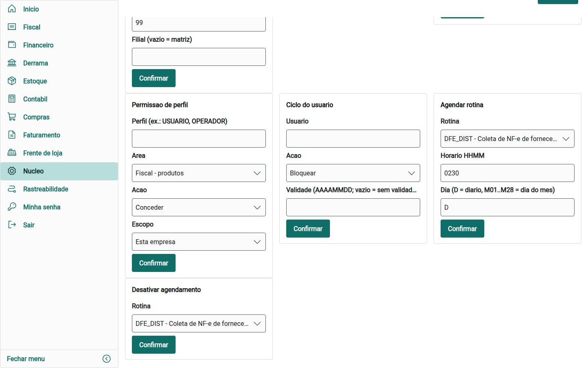 **Núcleo** — empresas, unidades, filiais, usuários, permissões e agendamentos | 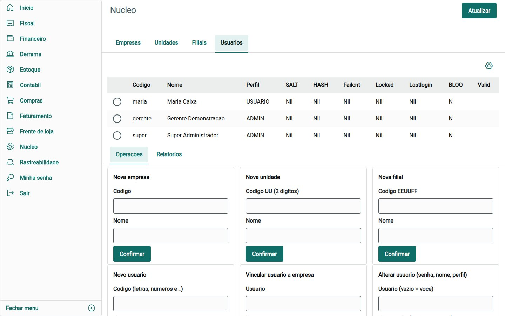 **Usuários** — cadastro e vínculos por empresa |
| 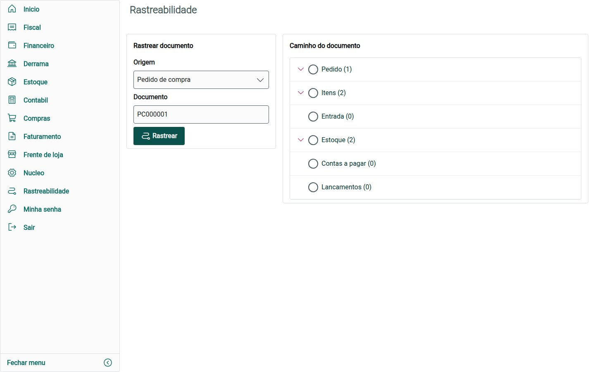 **Rastreabilidade** — o caminho de um documento em árvore | |

## Como funciona

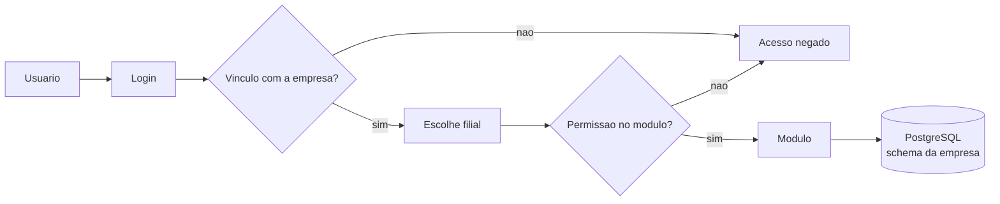

**Acessos em camadas.** A permissão só vale com vínculo com a empresa. Sem vínculo, nada se abre, mesmo que a permissão exista.

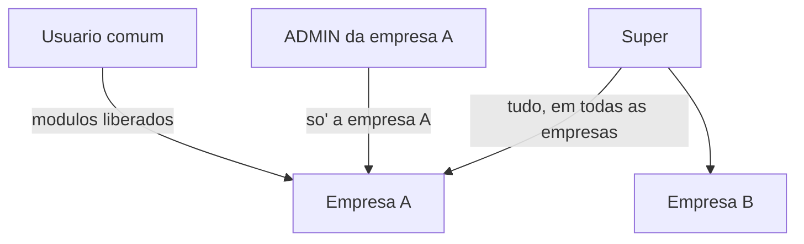

---

## Ciclo de vida do usuário

| Ação | Quem pode | Efeito |
|------|-----------|--------|
| Bloquear / desbloquear | Super | Impede o login em todas as empresas |
| Validade do acesso | Super | Acesso vence na data; vencido = bloqueado |
| Eliminar acessos | Super ou ADMIN | Remove os vínculos; reversível |
| Excluir | Super | Só para quem nunca acessou |
| Trocar senha no próximo logon | Super ou ADMIN | Obriga a troca antes de entrar |
| Conta de serviço | Super | Dispensa a troca periódica de senha |

A conta super nunca é bloqueada, nunca vence e nunca perde acessos. Erros de login não revelam se a conta existe.

---

## Agendador de rotinas

Cada empresa agenda as próprias rotinas. Um executor roda a cada minuto e dispara o que está devido.

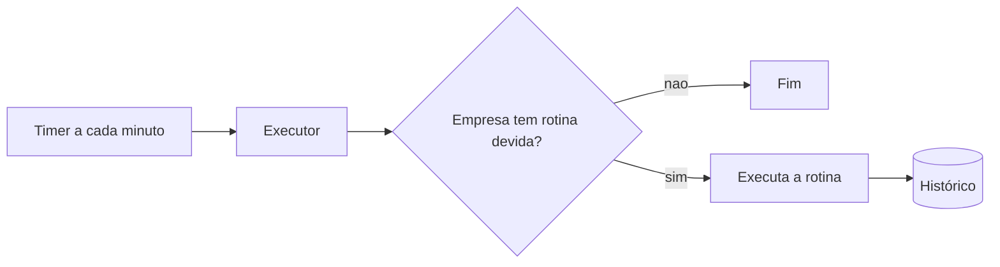

- **Horário e dia:** diário ou dia do mês (1 a 28).
- **Atraso:** se o horário passou, roda na próxima passada, uma vez por dia.
- **Rotinas disponíveis:** coleta de DF-e por NSU e apuração do Simples do mês anterior.
- **Segurança:** só rotinas de uma lista fechada, e só o super ou o ADMIN da empresa agendam.


---

## Fiscal


Documentos emitidos, transmitidos, cancelados e inutilizados com a mesma regra de negócio. A emissão real depende de certificado digital A1 e da homologação na SEFAZ de cada UF.

---

## Requisitos

- **advplc 4.6.1** ou mais novo.
- **PostgreSQL**.
- Certificado digital A1, para emissão real de documentos fiscais.

## Começando

```bash
# verificar a sintaxe de um fonte
advplc check src/GEBTUI.prw --include src

# terminal (TUI)
advplc serve src/GEBTUI.prw --port 8081

# API e login web
advplc run src/GEBWEB.prw
```

Configure a conexão com as variáveis `GEBAN_PG_HOST`, `GEBAN_PG_PORT`, `GEBAN_PG_USER`, `GEBAN_PG_PASSWORD` e `GEBAN_PG_DB`.

### Primeiro acesso

Numa instalação nova (catálogo de usuários vazio), o primeiro boot cria automaticamente a conta administrativa global **`super`** com a senha **`Geban#2026`**. No primeiro login o sistema exige a troca da senha antes de liberar o acesso — a senha padrão não volta a valer. Para usar outra senha inicial, exporte `GEBAN_SUPER_SENHA` **antes** do primeiro boot.

Com o `super` você cria a primeira empresa (o sistema pede código e nome na hora) e depois cadastra os usuários do dia a dia em **Núcleo**. Instalações existentes nunca têm a credencial redefinida por esse mecanismo.

### Validação no Windows (all-in-one)

O pacote `packaging/windows/dist/geban-setup.exe` foi instalado e exercitado de ponta a ponta numa máquina **Windows 10 limpa** (sem ferramentas de desenvolvimento, sem VC++ Redistributable prévio):

- Instalação por usuário em `%LOCALAPPDATA%\GEBAN`, sem exigir administrador; desinstalador, atalhos e inicialização com o Windows funcionando.
- PostgreSQL embarcado inicializado no primeiro boot (`initdb`), escutando só em `127.0.0.1:5432`; UI em `127.0.0.1:8081` e API em `127.0.0.1:8090` — sem alerta do Firewall e sem exposição na rede local.
- Login completo na interface web do Windows: `super` → troca de senha obrigatória → criação da primeira empresa → menu principal com todos os módulos.

Revalidado em 21/11/2026 com o AdvPP 4.8.5 e a interface PO-UI, numa instalação limpa: instalador em português do Brasil, primeiro boot, login, troca obrigatória, primeira empresa e Início. O agendador (`GEBSCHJOB`, a cada minuto) roda em segundo plano, sem abrir janela.

| Login | Troca de senha obrigatória | Primeira empresa | Início |
|---|---|---|---|
| 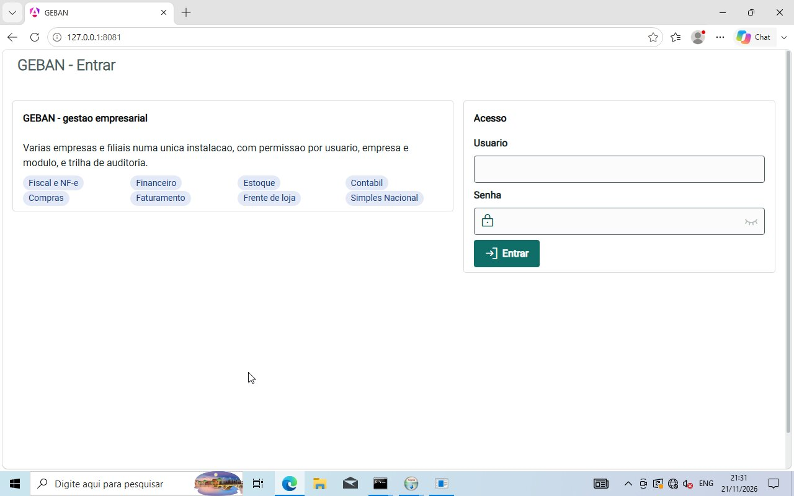 | 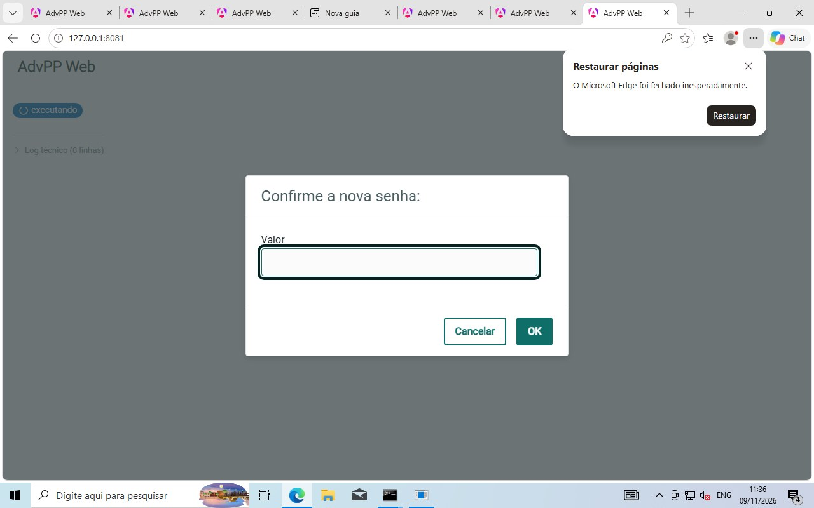 | 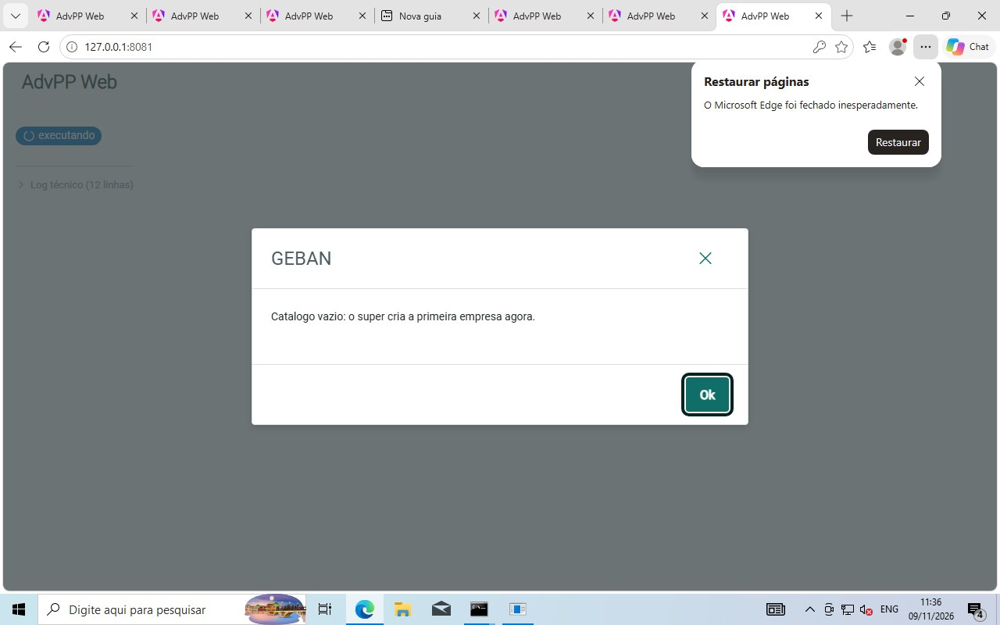 | 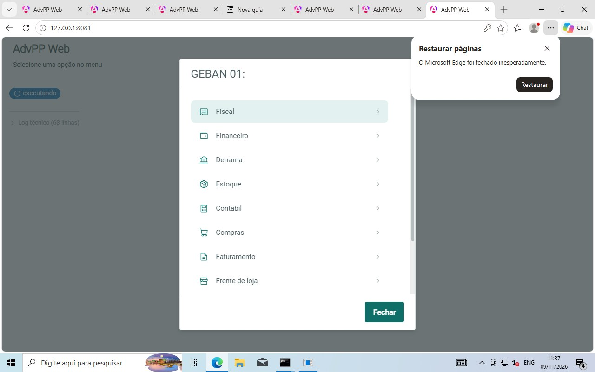 |

Depois:

1. Crie a empresa e a filial no **Núcleo**.
2. Cadastre os usuários e vincule cada um às empresas e filiais.
3. Libere os módulos em **Núcleo → Permissão de perfil**.
4. Agende as rotinas recorrentes em **Núcleo → Agendar rotina**.

## Testes

Cada teste em `tests/T_*.prw` cria um schema descartável e o remove ao final. Rode em um banco de teste dedicado, nunca no banco de produção.

## Estado atual

- **Emissão fiscal:** motor completo e testado contra emuladores de SEFAZ e Sefin. A homologação real em cada UF ainda precisa ser feita com certificado A1.
- **EFD ICMS/IPI:** gerada e validada localmente. A validação no programa PVA da Receita ainda não foi feita.
- **Agendador:** em produção, com as rotinas de DF-e e Simples.

## Documentação

| Documento | Conteúdo |
|-----------|----------|
| [Manual do usuário](docs/08-manual-do-usuario.md) ([PDF](docs/08-manual-do-usuario.pdf)) | Passo a passo de todas as telas, com capturas anotadas de cada módulo e de cada formulário |
| [Documentação técnica](docs/01-documentacao-tecnica.md) | Arquitetura e módulos |
| [Regras de negócio](docs/02-regras-negocio.md) | Regras de negócio e domínio |
| [Especificação funcional](docs/03-especificacao-funcional.md) | Especificação funcional |
| [Manual de utilização](docs/04-manual-utilizacao.md) | Passo a passo de uso |
| [Referência técnica](docs/05-referencia-tecnica.md) | Rotas, tabelas e funções |
| [Guia funcional](docs/06-guia-funcional.md) | Guia para o dia a dia |
| [Changelog](CHANGELOG.md) | Histórico de mudanças |

## Licença

[Apache License 2.0](LICENSE) — uso comercial livre, com atribuição.
Copyright 2026 Peder Munksgaard.
