# GEBAN — Manual do Usuário

> Passo a passo de todas as telas do GEBAN: instalação nova, rotina do dia a dia e referência de cada formulário de cada módulo.

## Como ler este manual

Todas as figuras são telas reais do GEBAN, capturadas numa empresa de
demonstração (Comercial Banana Ltda) em que os fluxos deste manual foram
executados de verdade.

- Nas telas inteiras, uma **moldura laranja numerada** mostra o menu, a aba,
  o campo ou o botão a usar, e um **balão escuro** resume a ação.
- Nos **recortes de formulário** da Parte 3, cada campo e cada botão tem um
  número. A lista abaixo da figura explica os números na mesma ordem.

Datas aparecem no formato `AAAAMMDD` (22/11/2026 = `20261122`) e
competências no formato `AAAAMM` (`202611`). Valores usam ponto decimal no
campo (`5.90`); o GEBAN mostra `5,90` nas tabelas.

### Sumário

- Parte 1 — Primeiros passos: entrar, trocar a senha, criar a empresa, tela Início
- Parte 2 — A rotina, passo a passo: produtos, estoque, financeiro, vendas, compras, apuração, frente de loja e relatórios
- Parte 3 — Referência de cada módulo e de cada formulário
- Parte 4 — Perguntas frequentes

---

# Parte 1 — Primeiros passos

## 1.1 Entrar pela primeira vez

Numa instalação nova, o GEBAN cria o usuário `super` com uma senha inicial
(a do arquivo de primeiro acesso do instalador, ou a definida em
`GEBAN_SUPER_SENHA` no servidor).

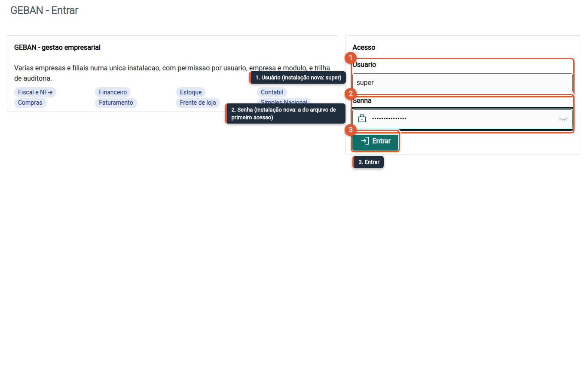

1. **Usuário**: `super` na instalação nova; depois, o seu usuário.
2. **Senha**.
3. Clique em **Entrar**.

## 1.2 Trocar a senha (obrigatório no primeiro acesso)

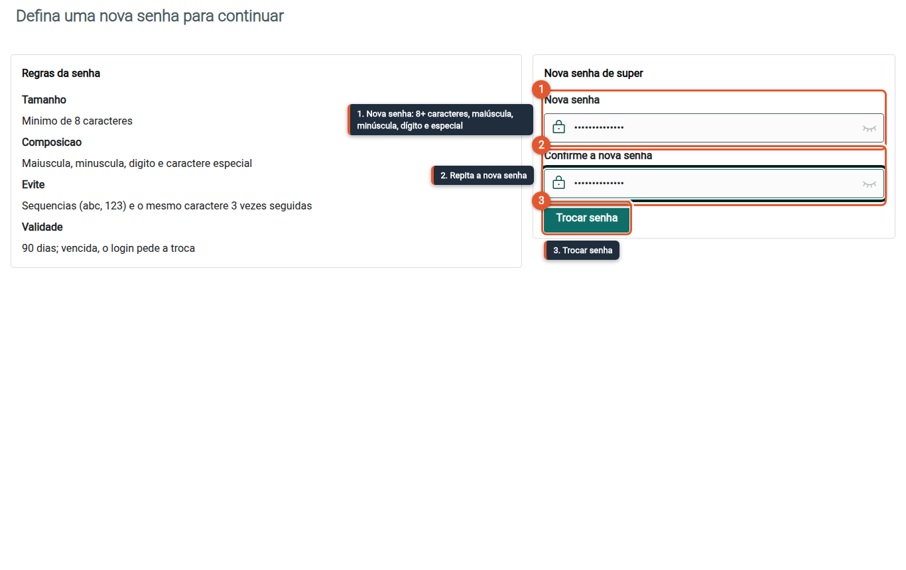

1. **Nova senha**: no mínimo 8 caracteres, com maiúscula, minúscula, dígito e
   caractere especial; sem sequências (`abc`, `123`) e sem o mesmo caractere 3
   vezes seguidas. A senha vale 90 dias; vencida, o GEBAN pede a troca no login.
2. **Confirme a nova senha**.
3. Clique em **Trocar senha**.

## 1.3 Criar a primeira empresa

Com o catálogo vazio, o GEBAN pede a primeira empresa. Cada empresa tem os
dados totalmente separados.

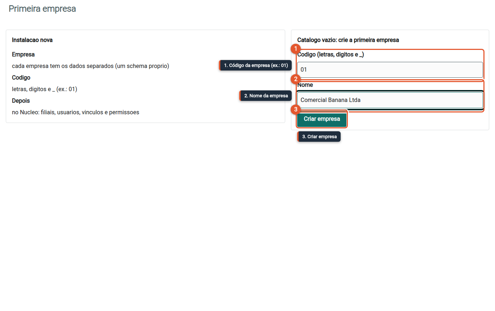

1. **Código**: letras, dígitos e `_` (ex.: `01`).
2. **Nome** da empresa.
3. Clique em **Criar empresa**. O GEBAN cria a empresa, a filial matriz e abre
   a tela Início. Filiais, usuários e permissões ficam no módulo Núcleo
   (seção 3.9).

## 1.4 A tela Início

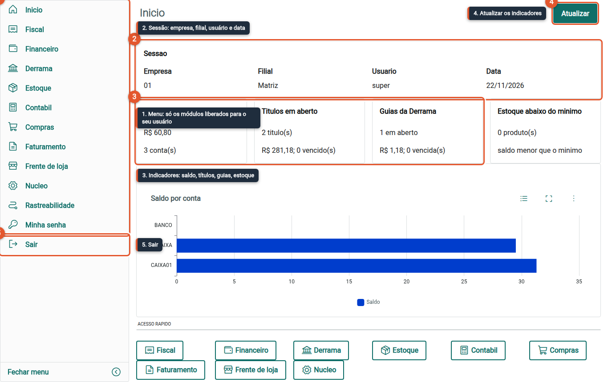

1. **Menu**: só aparecem os módulos liberados para o seu usuário.
2. **Sessão**: empresa, filial, usuário e data em que você está trabalhando.
3. **Indicadores**: saldo das contas, títulos em aberto e vencidos, guias da
   Derrama e produtos abaixo do estoque mínimo. Abaixo, o gráfico de saldo por
   conta e os botões de acesso rápido aos módulos.
4. **Atualizar** recalcula os indicadores.
5. **Sair** encerra a sessão.

## 1.5 Como funciona cada módulo

Todos os módulos têm o mesmo desenho:

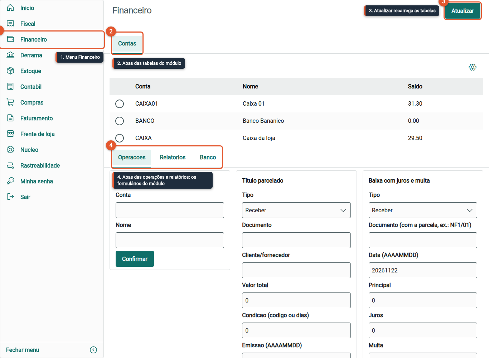

1. O **menu** do módulo.
2. **Abas das tabelas**: os dados do módulo (contas, produtos, notas...),
   sempre atualizados.
3. **Atualizar** recarrega as tabelas depois de uma operação.
4. **Abas das operações e relatórios**: cada aba tem vários **formulários**
   (quadros). Preencha os campos de um quadro e clique em **Confirmar**.

O resultado aparece num aviso no rodapé da tela. Os **relatórios** abrem
uma página de resultado; clique em **Voltar** para retornar ao módulo.

## 1.6 Minha senha

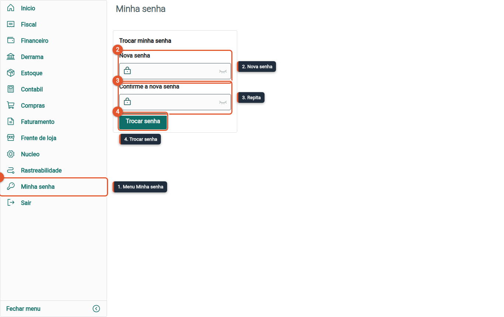

1. Menu **Minha senha**.
2. **Nova senha** (mesmas regras do item 1.2).
3. **Confirme a nova senha**.
4. **Trocar senha**.

---

# Parte 2 — A rotina, passo a passo

Os passos abaixo foram executados nesta ordem na empresa de demonstração.
Siga a mesma ordem ao implantar o GEBAN.

## 2.1 Cadastrar os produtos

**Fiscal → aba Operações → quadro Novo produto.**

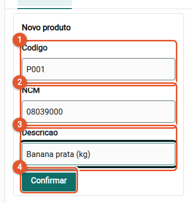

1. **Código** do produto (ex.: `P001`).
2. **NCM**: a classificação fiscal, 8 dígitos (`08039000` = bananas).
3. **Descrição**.
4. **Confirmar**. Aviso: *Produto criado.*

Repita para cada produto. Depois, em **Fiscal → Documentos eletrônicos →
DF-e: perfil fiscal de produto**, complete unidade, GTIN e tributação, se a
empresa emite NF-e ou NFC-e.

## 2.2 Dar entrada no estoque inicial

**Estoque → aba Operações → Movimento com custo (entrada/saida).**

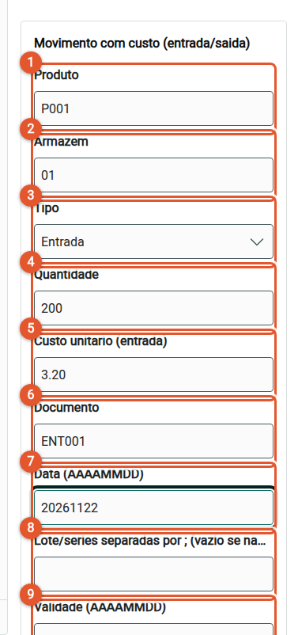

1. **Produto**.
2. **Armazém** (ex.: `01`).
3. **Tipo**: Entrada.
4. **Quantidade**.
5. **Custo unitário** da entrada (o GEBAN recalcula o custo médio).
6. **Documento**: um número para identificar o movimento (ex.: `ENT001`).
7. **Data** (`AAAAMMDD`).
8. a 10. **Lote/série**, **validade** e **endereço**: só para produtos com
   esses controles (ver *Controle de lote/serie/endereco*).
11. **Confirmar**. Aviso: *movimentado*.

## 2.3 Contas financeiras e condição de pagamento

**Financeiro → Operações → Nova conta.**

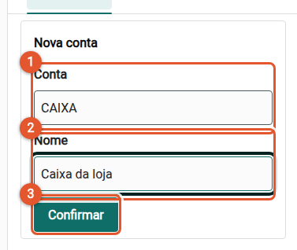

1. **Conta**: um código curto (ex.: `CAIXA`, `BANCO`).
2. **Nome**.
3. **Confirmar**. Aviso: *Conta criada.*

**Financeiro → Operações → Condicao de pagamento.**

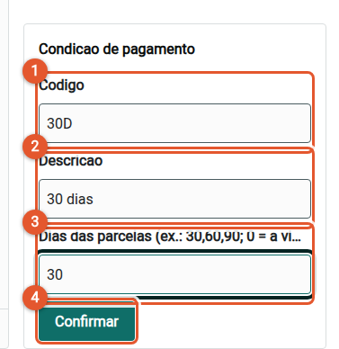

1. **Código** (ex.: `30D`).
2. **Descrição**.
3. **Dias das parcelas**: `30` (uma parcela em 30 dias), `30,60,90` (três
   parcelas), `0` (à vista).
4. **Confirmar**.

## 2.4 Clientes e tabela de preços

**Faturamento → Operações → Cliente (novo ou alterar).**

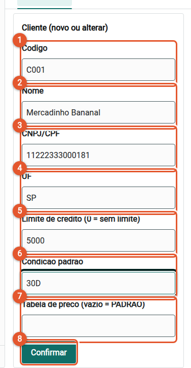

1. **Código** do cliente.
2. **Nome**.
3. **CNPJ/CPF**.
4. **UF**.
5. **Limite de crédito** (0 = sem limite). Pedido acima do limite fica
   bloqueado até ser liberado.
6. **Condição padrão** de pagamento.
7. **Tabela de preço** (vazio = `PADRAO`).
8. **Confirmar**. Aviso: *cliente C001 gravado*.

**Faturamento → Operações → Preco na tabela.**

1. **Tabela** (vazio = `PADRAO`).
2. **Produto**.
3. **Preço** de venda.
4. **Confirmar**.

## 2.5 Pedido de venda

**Faturamento → Operações → Pedido de venda.** Este quadro tem uma lista de
itens: preencha produto, quantidade e preço e clique em **Incluir item** para
cada item; depois preencha o cabeçalho e clique em **Confirmar**.

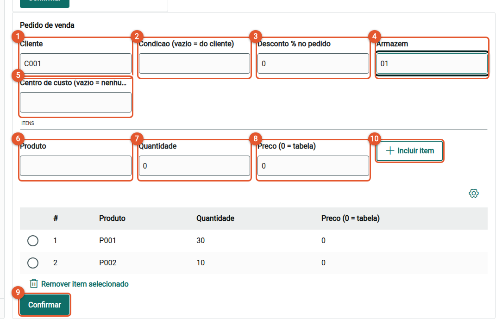

1. **Cliente**.
2. **Condição** (vazio = a do cliente).
3. **Desconto %** no pedido.
4. **Armazém** de onde sai a mercadoria.
5. **Centro de custo** (opcional).
6. a 8. **Produto**, **Quantidade** e **Preço** do item (preço `0` = da
   tabela).
9. **Confirmar** grava o pedido com os itens da lista (aviso: *pedido
   PV000001 gravado*).
10. **Incluir item** adiciona o item à lista logo abaixo. Para tirar um item,
    clique nele e em **Remover item selecionado**.

Para emitir a nota e baixar o estoque, use **Faturar pedido (documento de
saida)** (seção 3.7). Pedido bloqueado por crédito ou estoque é liberado em
**Liberar pedido**.

## 2.6 Compras: fornecedor, pedido e entrada da nota

**Compras → Operações**, nesta ordem:

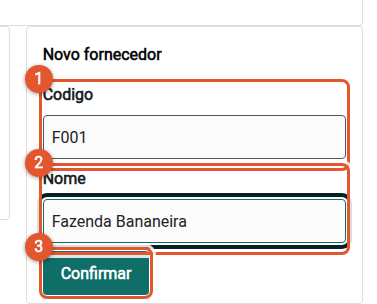

**Novo fornecedor**: 1. **Código**, 2. **Nome**, 3. **Confirmar**.

**Abrir pedido**: 1. número do **Pedido** (ex.: `PC001`), 2.
**Fornecedor**, 3. **Confirmar**.

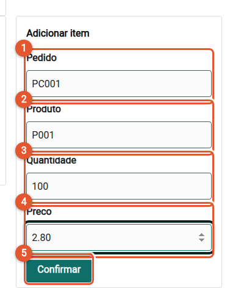

**Adicionar item**: 1. **Pedido**, 2. **Produto**, 3. **Quantidade**,
4. **Preço**, 5. **Confirmar**. Repita para cada item.

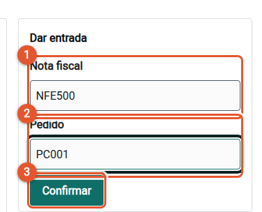

**Dar entrada**: 1. número da **Nota fiscal** do fornecedor, 2. **Pedido**,
3. **Confirmar**. Aviso: *Entrada registrada.* O GEBAN dá entrada no estoque
(recalculando o custo médio), gera o título a pagar e faz os lançamentos
contábeis.

Para pedidos com muitos itens, cotações, aprovação por alçada e entrada
parcial, use os quadros *Solicitacao de compra*, *Cotacao de fornecedor*,
*Pedido de compra com itens* e *Documento de entrada* (seção 3.6).

## 2.7 Venda direta (sem pedido)

**Estoque → Operações → Vender.**

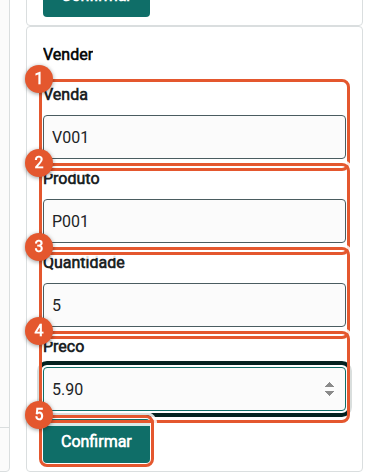

1. Número da **Venda**.
2. **Produto**.
3. **Quantidade**.
4. **Preço**.
5. **Confirmar**. Aviso: *Venda registrada.* O estoque baixa e o resultado
   (receita e custo) é lançado.

## 2.8 Títulos a receber e a pagar

**Financeiro → Operações → Titulo parcelado.**

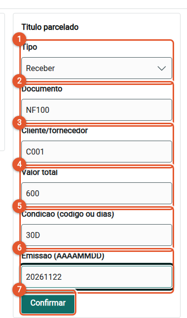

1. **Tipo**: Receber ou Pagar.
2. **Documento** (ex.: `NF100`). As parcelas ficam `NF100/01`, `NF100/02`...
3. **Cliente/fornecedor**.
4. **Valor total**.
5. **Condição** (código ou dias).
6. **Emissão**.
7. **Confirmar**. Aviso: *titulos gerados*.

Para receber ou pagar, use **Baixa com juros e multa** ou **Baixar titulo**
(seção 3.2).

## 2.9 Apuração dos tributos e guias

**Fiscal → Operações → Apurar competencia** soma o IBS/CBS das notas
**autorizadas** na SEFAZ da competência.

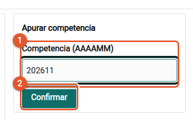

1. **Competência** (`AAAAMM`).
2. **Confirmar**. Aviso: *Competencia apurada.*

**Derrama → Operações → Gerar guia** gera a guia da competência apurada.

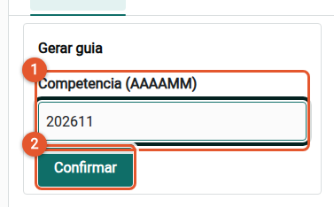

1. **Competência**.
2. **Confirmar**.

Na demonstração, a guia foi recusada (*Gerar guia recusado:
falha_gerar_guia*): sem notas autorizadas na SEFAZ, a apuração não tem
tributo a pagar e não há guia a gerar. Com a emissão eletrônica configurada
(Fiscal → Documentos eletrônicos), as notas autorizadas entram na apuração e
a guia é gerada.

### Empresa do Simples Nacional

**Fiscal → aba Simples Nacional.** Primeiro configure o anexo:

1. **Anexo** (I a V, ou Fator R).
2. **Início de atividade** (`AAAAMM`), só se a empresa tem menos de 12 meses.
3. **Confirmar**.

Depois, todo mês:

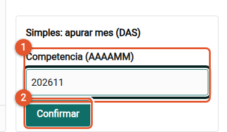

1. **Competência**.
2. **Confirmar**. O aviso mostra o cálculo. Na demonstração: *Anexo I, faixa
   1, RBT12 R$ 0,00, alíquota efetiva 4,0000%, DAS R$ 1,18, vence
   21/12/2026*.

## 2.10 Lançamento contábil direto

O GEBAN lança a contabilidade sozinho (vendas, compras, títulos, guias). O
lançamento manual é exceção e vem **desligado**.

1. **Conta a débito** (ex.: `4.02.006`).
2. **Conta a crédito** (ex.: `1.01.001`).
3. **Valor**.
4. **Confirmar**.

Na demonstração, o lançamento foi recusado (*lancamento_direto_desligado: o
parametro PERMITE_DIRETA da empresa nao esta S*). Para liberar, o
administrador do servidor define `PERMITE_DIRETA = S` nos parâmetros da
empresa. Além dessa trava, o perfil do usuário e a regra `LANC_DIRETO`
também precisam permitir.

## 2.11 Usuários

**Núcleo → Operações → Novo usuario.**

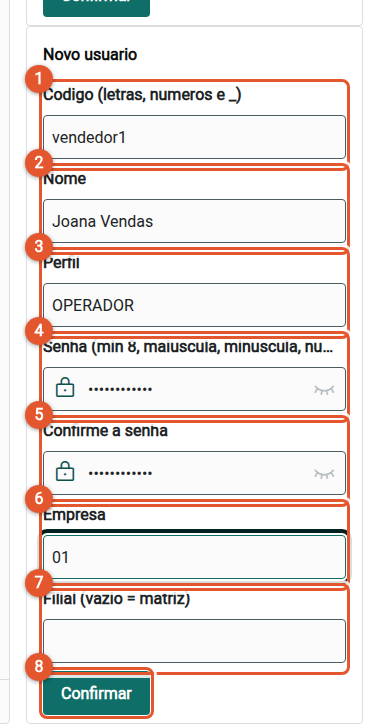

1. **Código** do usuário (letras, números e `_`).
2. **Nome**.
3. **Perfil** (ex.: `USUARIO`, `OPERADOR`, `ADMIN`): define o que ele pode
   fazer (ver *Permissao de perfil*).
4. **Senha** inicial (mesmas regras do item 1.2).
5. **Confirme a senha**.
6. **Empresa**.
7. **Filial** (vazio = matriz).
8. **Confirmar**. Aviso: *gravado*.

## 2.12 PDV (frente de caixa)

> **Nota:** a frente de caixa é o **PDV web** (`/pdv` no servidor GEBWEB, porta 8090 — ex.: `http://servidor:8090/pdv`), com login próprio (empresa/usuário/senha) e abas equivalentes às do antigo módulo: **Venda** (carrinho, formas de pagamento inclusive crypto com QR Code), **Caixa** (abrir/fechar, sangria/suprimento, cancelar cupom, resumo), **Orçamentos**, **Devolução**, **Consultas** (preço, vale, fiado, 2ª via, DANFE), **Cadastros** (caixa, barras/PLU, promoção, vendedor), **Relatórios** e **TEF / NFC-e**. O antigo módulo "Frente de loja" do TUI foi descontinuado; as seções abaixo descrevem as mesmas operações de caixa — no PDV web elas aparecem nas abas correspondentes.

### As abas do PDV web

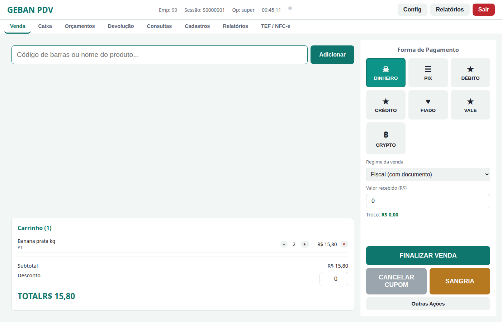

A aba **Venda** concentra a operação: leitor de código/barras, carrinho com quantidades, desconto, regime da venda (Fiscal ou Comprovante) e as formas de pagamento — Dinheiro (com troco), PIX, Débito, Crédito (parcelas), Fiado (com verificação de limite), Vale e **CRYPTO** (escolhe a moeda, mostra a cotação e gera o QR Code).

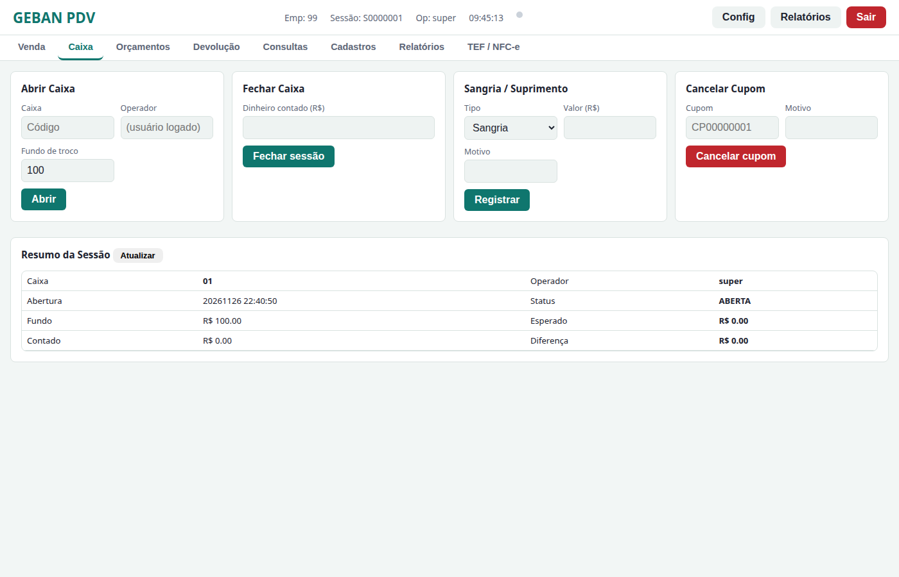

A aba **Caixa** abre e fecha a sessão (com dinheiro contado e diferença), registra **sangria/suprimento**, cancela cupom e mostra o **resumo da sessão** (fundo, esperado, contado, movimentos).

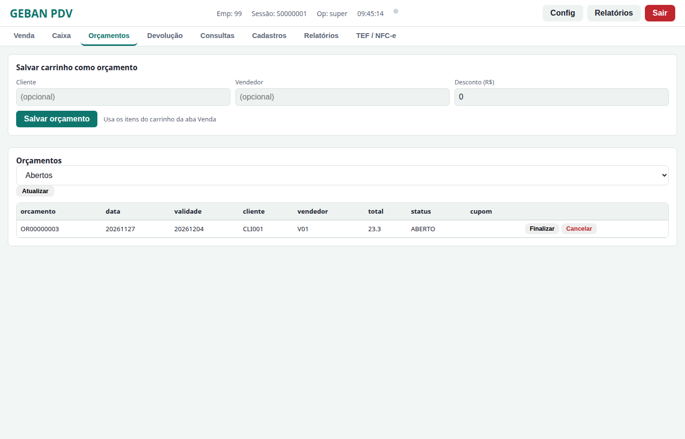

A aba **Orçamentos** salva o carrinho atual como orçamento (cliente, vendedor, desconto), lista por status e permite **finalizar** em cupom (pagamento, CPF na nota e regime) ou **cancelar**.

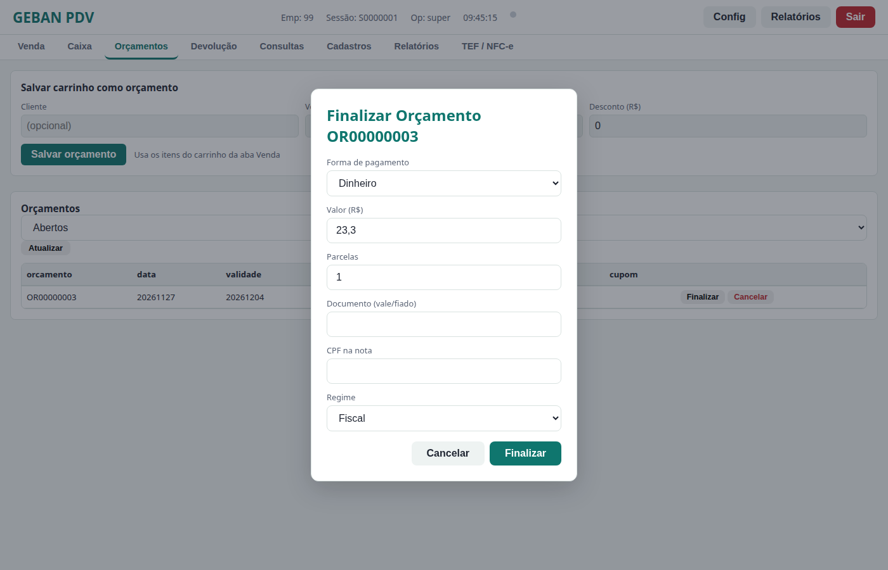

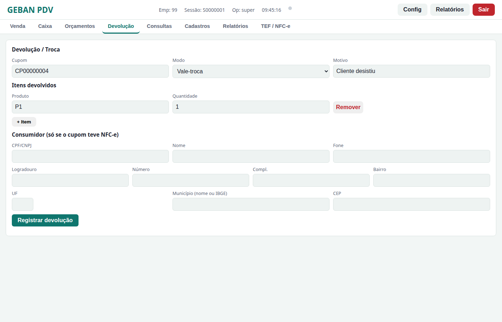

A aba **Devolução** registra a devolução/troca de itens de um cupom (modo dinheiro ou **vale-troca**), com os dados do consumidor quando o cupom teve NFC-e (a devolução emite NF-e de entrada — o município aceita nome ou código IBGE).

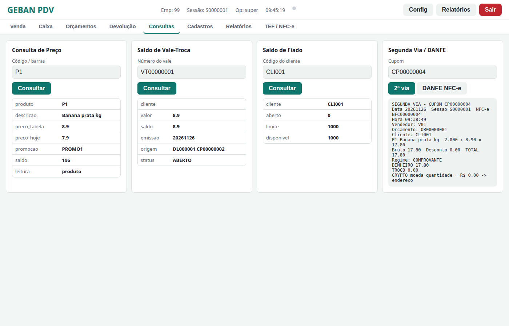

A aba **Consultas** mostra preço do produto (com promoção aplicada e saldo), saldo de **vale-troca**, saldo de **fiado** do cliente, a **segunda via** do cupom em texto e o link do **DANFE NFC-e**.

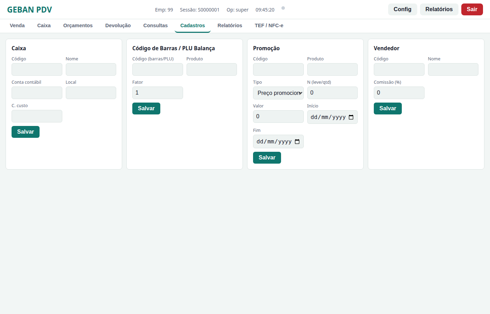

A aba **Cadastros** mantém caixa, código de barras/PLU de balança, promoção e vendedor — direto do caixa, sem entrar no ERP.

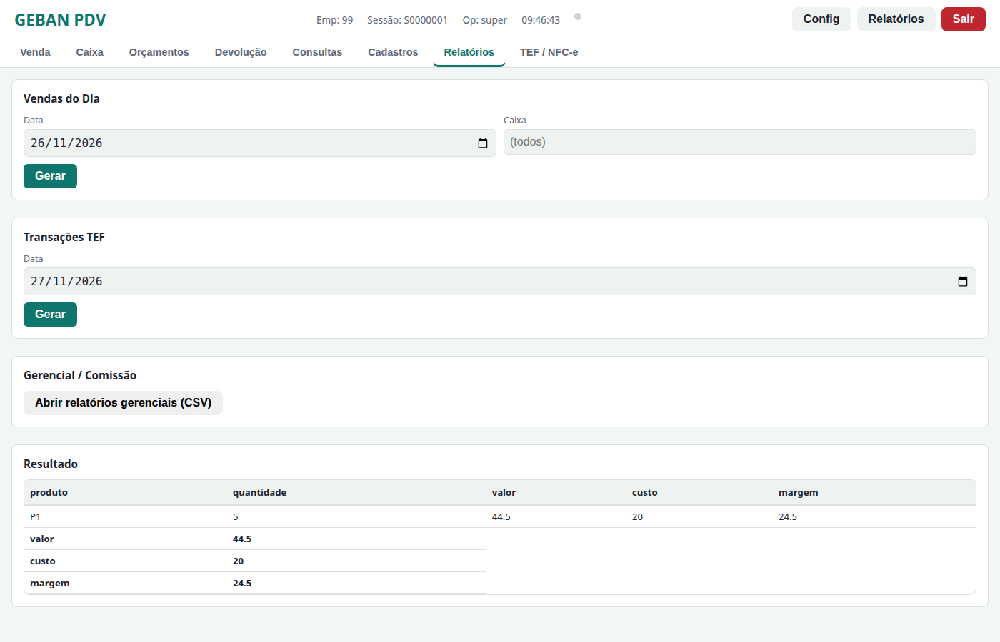

A aba **Relatórios** gera as **vendas do dia** (produto × quantidade × valor × custo × margem, com totais), as **transações TEF** e os relatórios gerencial/comissão em CSV.

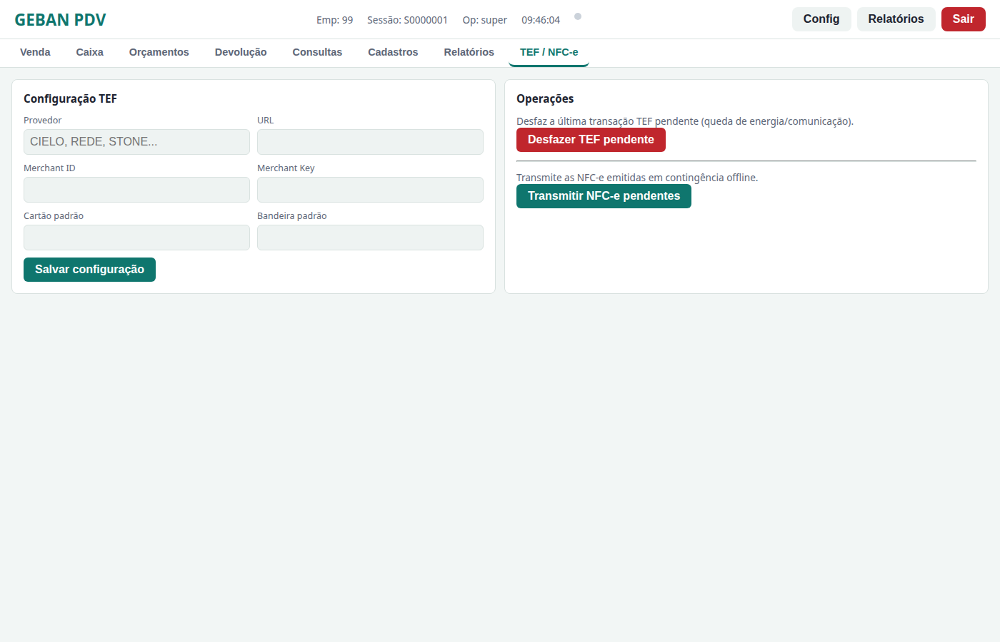

A aba **TEF / NFC-e** configura o provedor TEF, desfaz transação pendente (queda de energia/comunicação) e transmite as NFC-e emitidas em contingência.

### Preparar a loja (uma vez)

**Frente de loja → aba Cadastros → Cadastrar caixa.**

1. **Código do caixa** (ex.: `01`).
2. **Nome**.
3. **Conta do dinheiro** (vazio = `CAIXA<código>`, criada sozinha).
4. **Armazém** de onde sai a mercadoria.
5. **Centro de custo** (opcional).
6. **Confirmar**. Aviso: *caixa 01 gravado (conta CAIXA01)*.

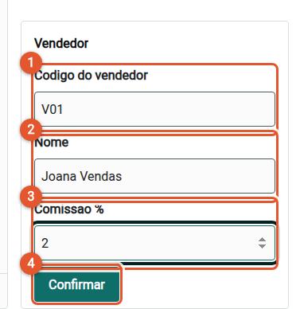

**Vendedor**: 1. **Código**, 2. **Nome**, 3. **Comissão %**,
4. **Confirmar**.

### Abrir o caixa (todo dia)

**Frente de loja → aba Caixa → Abrir caixa.**

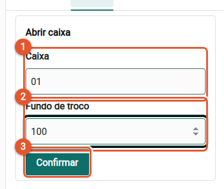

1. **Caixa**.
2. **Fundo de troco**.
3. **Confirmar**. Aviso: *sessao S0000001 aberta*.

### Vender

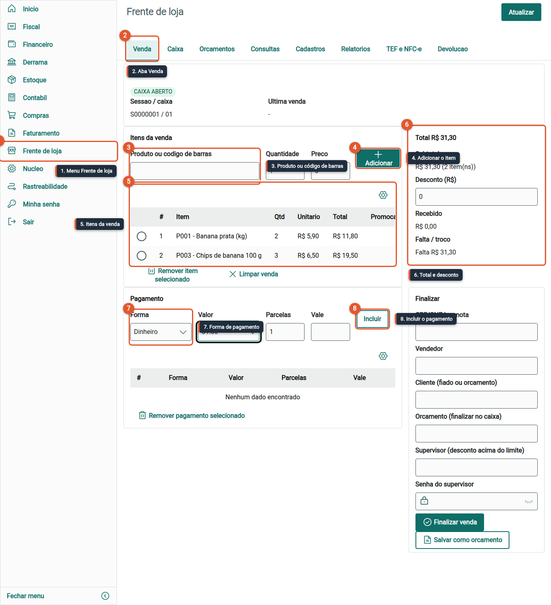

1. Menu **Frente de loja**.
2. Aba **Venda**.
3. **Produto ou código de barras** (ou leia com o leitor). Ajuste a
   **Quantidade** se precisar.
4. **Adicionar**: o item entra no cupom.
5. A lista **Itens da venda**. Para tirar um item, clique nele e em **Remover
   item selecionado**; **Limpar venda** recomeça.
6. **Total**: subtotal, **Desconto (R$)**, recebido e falta/troco.
7. **Forma** de pagamento (dinheiro, PIX, débito, crédito, fiado,
   vale-troca) e **Valor**. Em cartão, informe as **Parcelas**.
8. **Incluir** o pagamento. Pode usar várias formas até cobrir o total.

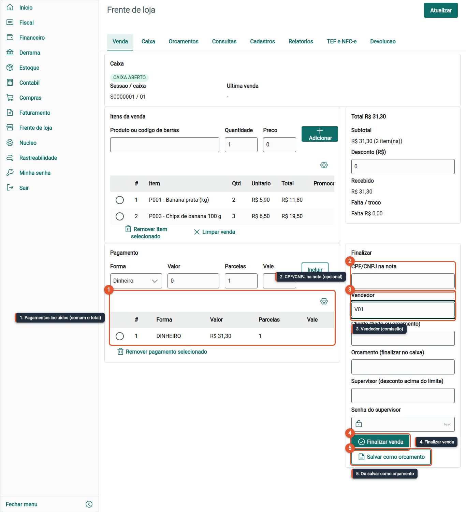

1. Os **pagamentos** incluídos.
2. **CPF/CNPJ na nota** (opcional).
3. **Vendedor** (para a comissão).
4. **Finalizar venda**: emite o cupom e a NFC-e.
5. Ou **Salvar como orçamento**, para finalizar depois no caixa.

Desconto acima do limite exige **Supervisor** e **Senha do supervisor**.
**Cliente** é obrigatório para venda fiado.

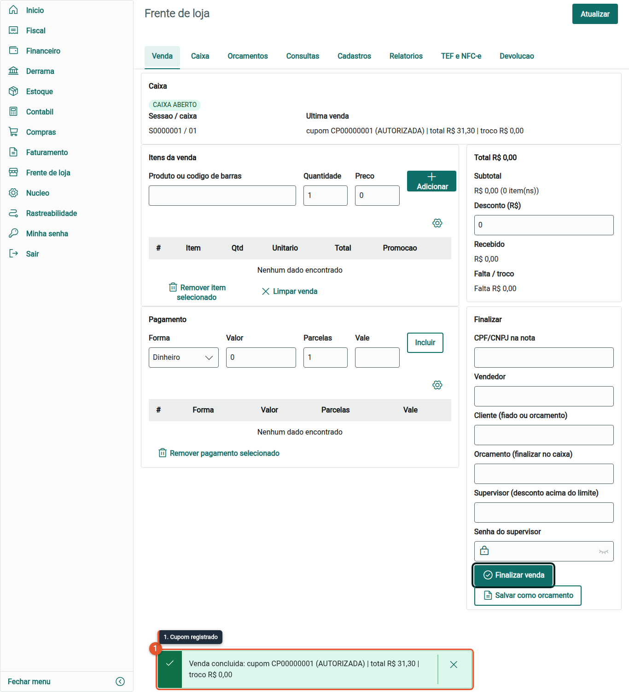

1. Aviso com o cupom, a situação da NFC-e, o total e o troco. Na
   demonstração: *Venda concluida: cupom CP00000001 (AUTORIZADA), total
   R$ 31,30, troco R$ 0,00*.

No fim do dia: **Caixa → Fechar caixa**, informando o dinheiro contado na
gaveta (seção 3.8).

## 2.13 Rastreabilidade

Mostra o caminho de um documento por todo o sistema, até os lançamentos
contábeis.

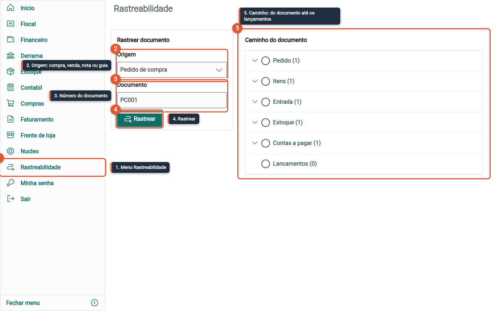

1. Menu **Rastreabilidade**.
2. **Origem**: pedido de compra, venda, nota fiscal (chave) ou guia da
   Derrama.
3. **Documento** (ex.: `PC001`).
4. **Rastrear**.
5. **Caminho do documento**: pedido → itens → entrada → estoque → contas a
   pagar → lançamentos. Clique nos nós para ver os detalhes.

## 2.14 Relatórios

Os relatórios ficam nas abas **Relatórios** de cada módulo. Preencha o
período e clique em **Confirmar**; o resultado abre numa página própria
(**Voltar** retorna). Exemplos reais da demonstração:

**Estoque — posição valorizada**

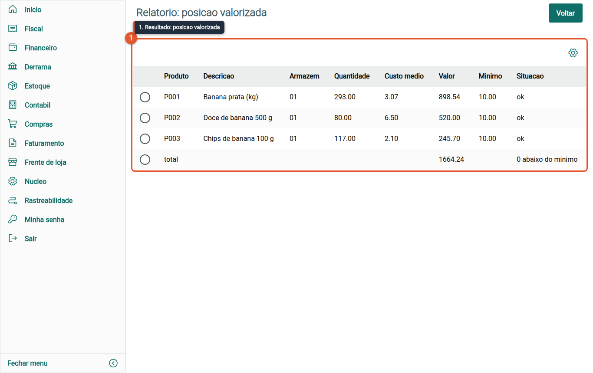

**Contábil — balancete do período**

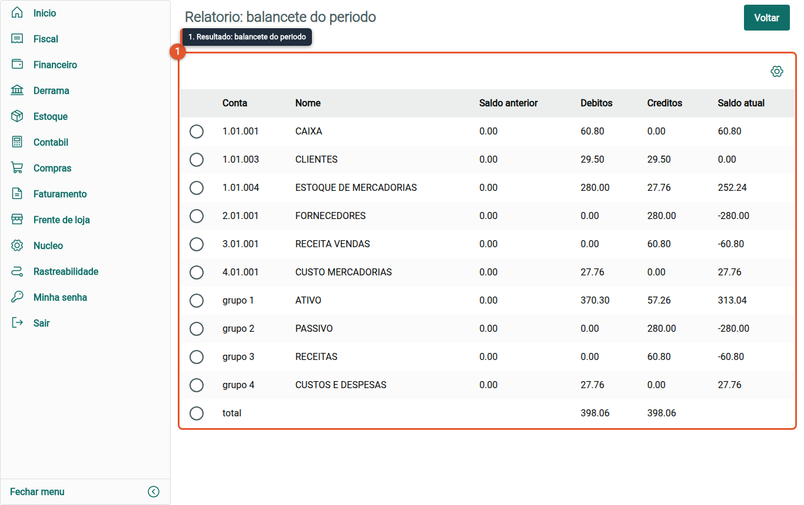

**Frente de loja — vendas do dia**

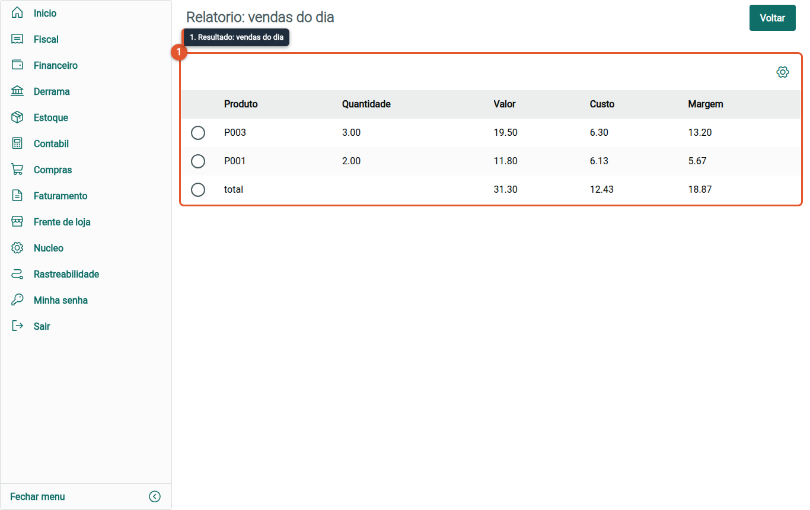

**Financeiro — extrato da conta**

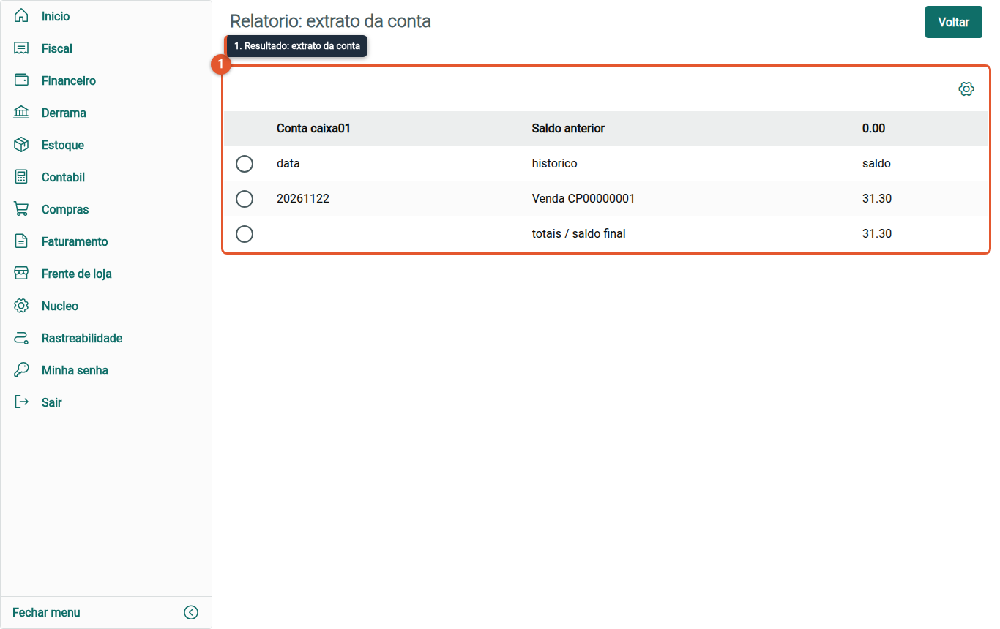

---

# Parte 3 — Referência dos módulos

Cada seção começa pela tela do módulo e traz, aba por aba, todos os
formulários. Em cada recorte, os números seguem a ordem dos campos; o último
número é o botão (normalmente **Confirmar**). Os valores preenchidos são
exemplos.

## 3.1 Fiscal

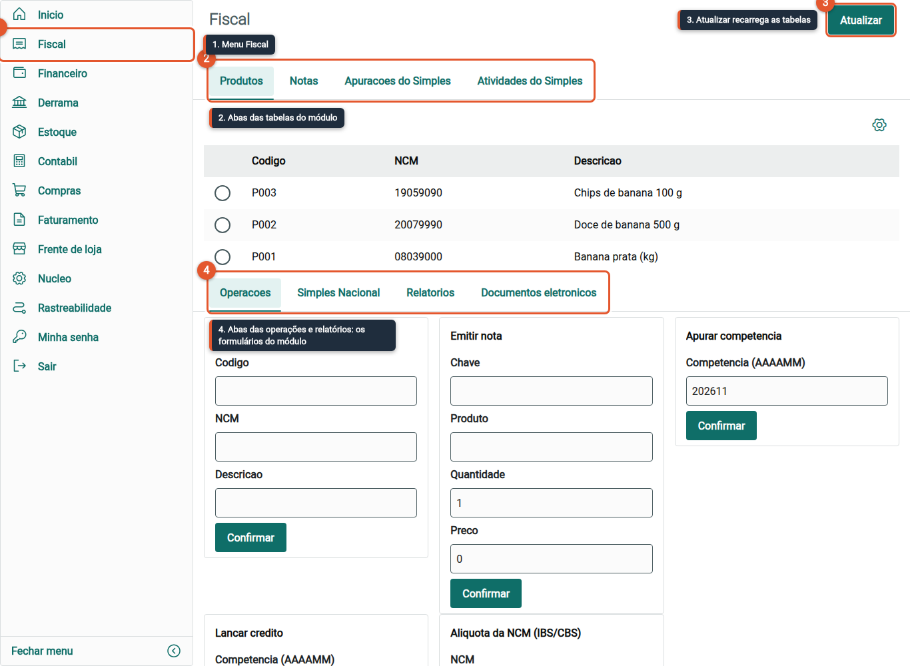

1. Menu **Fiscal**.
2. **Abas das tabelas**: Produtos, Notas, Apuracoes do Simples, Atividades do Simples.
3. **Atualizar** recarrega as tabelas.
4. **Abas dos formulários**: Operacoes, Simples Nacional, Relatorios, Documentos eletronicos.

### Fiscal → aba Operacoes

#### Novo produto

Cadastra um produto com o código, a NCM (classificação fiscal de 8 dígitos) e a descrição. É o primeiro passo antes de comprar, estocar ou vender.

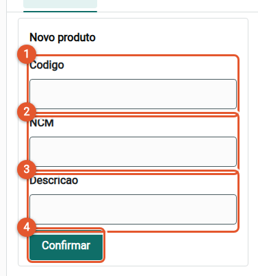

1. **Codigo**
2. **NCM**
3. **Descricao**
4. **Confirmar**: executa a operação.

#### Emitir nota

Registra uma nota de venda simples (chave/número, produto, quantidade e preço) no livro fiscal.

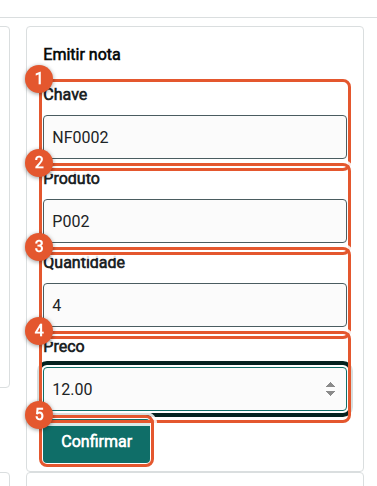

1. **Chave**
2. **Produto**
3. **Quantidade**
4. **Preco**
5. **Confirmar**: executa a operação.

#### Apurar competencia

Soma os tributos (IBS/CBS) das notas autorizadas da competência, descontando devoluções e créditos de compra.

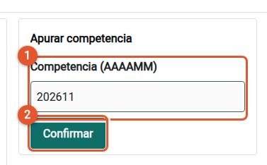

1. **Competencia (AAAAMM)**
2. **Confirmar**: executa a operação.

#### Lancar credito

Lança um crédito de tributo da competência (por exemplo, de uma compra), que abate o valor a pagar na apuração.

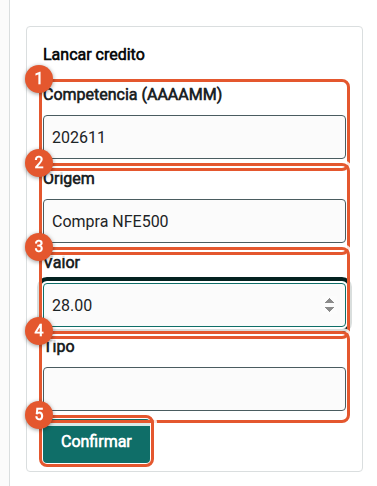

1. **Competencia (AAAAMM)**
2. **Origem**
3. **Valor**
4. **Tipo**
5. **Confirmar**: executa a operação.

#### Aliquota da NCM (IBS/CBS)

Define as alíquotas de IBS e CBS de uma NCM, com início e fim de vigência.

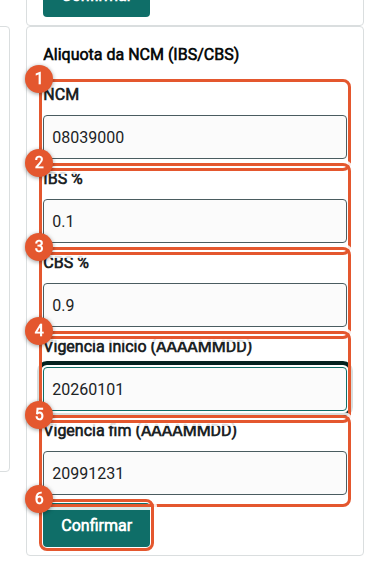

1. **NCM**
2. **IBS %**
3. **CBS %**
4. **Vigencia inicio (AAAAMMDD)**
5. **Vigencia fim (AAAAMMDD)**
6. **Confirmar**: executa a operação.

### Fiscal → aba Simples Nacional

#### Simples: configurar anexo padrao

Escolhe o anexo do Simples Nacional da empresa (I a V, ou Fator R) e, para empresa nova, o mês de início de atividade.

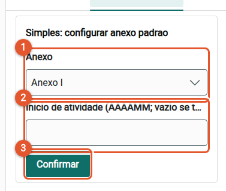

1. **Anexo**
2. **Inicio de atividade (AAAAMM; vazio se tem mais de 12 meses)**
3. **Confirmar**: executa a operação.

#### Simples: atividade (codigo e anexo)

Cadastra uma atividade com o seu anexo, para empresas com receitas de anexos diferentes.

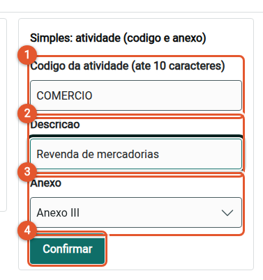

1. **Codigo da atividade (ate 10 caracteres)**
2. **Descricao**
3. **Anexo**
4. **Confirmar**: executa a operação.

#### Simples: produto (atividade, ST, monofasico)

Liga o produto a uma atividade e marca se tem ICMS por substituição tributária ou PIS/COFINS monofásico (essas parcelas saem do DAS).

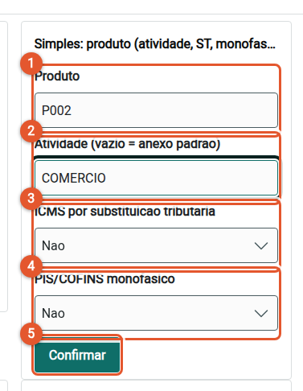

1. **Produto**
2. **Atividade (vazio = anexo padrao)**
3. **ICMS por substituicao tributaria**
4. **PIS/COFINS monofasico**
5. **Confirmar**: executa a operação.

#### Simples: nota de exportacao

Marca uma nota como exportação, que no Simples tem tratamento próprio.

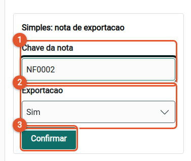

1. **Chave da nota**
2. **Exportacao**
3. **Confirmar**: executa a operação.

#### Simples: folha e receita externa do mes

Informa a folha de pagamento do mês (para o Fator R) e receitas que não passaram pelo GEBAN.

1. **Competencia (AAAAMM)**
2. **Folha do mes (salarios + pro-labore + encargos)**
3. **Receita do mes fora do GEBAN**
4. **Atividade da receita (vazio = anexo padrao)**
5. **Confirmar**: executa a operação.

#### Simples: feriado municipal/estadual

Cadastra um feriado local, usado para empurrar o vencimento do DAS para o próximo dia útil.

1. **Data do feriado (AAAAMMDD)**
2. **Descricao**
3. **Confirmar**: executa a operação.

#### Simples: apurar mes (DAS)

Calcula o DAS do mês: receita bruta dos 12 meses (RBT12), faixa, alíquota efetiva, valor e vencimento.

1. **Competencia (AAAAMM)**
2. **Confirmar**: executa a operação.

### Fiscal → aba Relatorios

#### Relatorio: extrato da apuracao do Simples

Mostra o detalhamento da apuração do Simples da competência.

1. **Competencia (AAAAMM)**
2. **Confirmar**: executa a operação.

Resultado:

#### Relatorio: acompanhamento anual do Simples

Mostra, mês a mês, a receita e o DAS do ano, para acompanhar o limite do Simples.

1. **Ano (AAAA)**
2. **Confirmar**: executa a operação.

#### Relatorio: documentos eletronicos

Lista NF-e, NFC-e e NFS-e do período, com a situação na SEFAZ.

1. **Inicio (AAAAMMDD)**
2. **Fim (AAAAMMDD)**
3. **Situacao (vazio = todas)**
4. **Confirmar**: executa a operação.

### Fiscal → aba Documentos eletronicos

#### DF-e: o que falta para emitir (roteiro)

Confere o que ainda falta configurar para emitir documentos eletrônicos e, opcionalmente, testa a comunicação com a SEFAZ.

1. **Testar a comunicacao com a SEFAZ agora**
2. **Confirmar**: executa a operação.

#### DF-e: emitente (CNPJ, IE, regime, endereco)

Cadastra os dados da empresa que aparecem nas notas: CNPJ, inscrição estadual, razão social, regime e endereço.

1. **CNPJ**
2. **Inscricao estadual**
3. **Razao social**
4. **Nome fantasia**
5. **Regime**
6. **Inscricao municipal (vazio = nao tem)**
7. **CNAE (vazio = nao informa)**
8. **Logradouro**
9. **Numero**
10. **Complemento**
11. **Bairro**
12. **UF**
13. **Municipio (nome ou codigo IBGE)**
14. **CEP**
15. **Telefone**
16. **E-mail**
17. **Confirmar**: executa a operação.

#### DF-e: certificado digital A1

Mostra e confere o certificado digital A1 instalado, necessário para assinar as notas.

1. **Confirmar**: executa a operação.

#### DF-e: configuracao (ambiente, NFC-e, serie, CSC, padroes)

Escolhe o ambiente (homologação ou produção), liga NFC-e e NF-e, define séries, CSC e padrões de emissão.

1. **Ambiente**
2. **NFC-e na frente de loja**
3. **Serie da NFC-e**
4. **NF-e no faturamento e nas devolucoes**
5. **Serie da NF-e**
6. **Forma de pagamento da NF-e de venda (15 boleto, 99 outros...)**
7. **NFS-e (servicos, padrao nacional)**
8. **Serie da DPS**
9. **Proximo numero da NFC-e (vazio = segue a numeracao)**
10. **CFOP padrao**
11. **CSOSN padrao (Simples)**
12. **Unidade padrao**
13. **ID do CSC (so' QR Code versao 2)**
14. **Codigo CSC (vazio = mantem o atual)**
15. **Responsavel tecnico: CNPJ (vazio = nao informa)**
16. **Responsavel tecnico: contato**
17. **Responsavel tecnico: e-mail**
18. **Responsavel tecnico: telefone**
19. **Confirmar**: executa a operação.

#### DF-e: perfil fiscal de produto

Define, por produto, unidade, GTIN, CFOP, CSOSN/CST e alíquotas usados nas notas.

1. **Produto**
2. **Unidade (vazio = padrao)**
3. **GTIN/EAN (vazio = do codigo de barras da loja)**
4. **CFOP (vazio = padrao)**
5. **CSOSN (Simples; vazio = padrao)**
6. **CST do ICMS (regime normal; vazio = padrao)**
7. **Aliquota do ICMS % (regime normal)**
8. **CEST (vazio = nao tem)**
9. **Origem 0 a 8 (vazio = padrao)**
10. **CST do PIS (vazio = padrao)**
11. **CST da COFINS (vazio = padrao)**
12. **Confirmar**: executa a operação.

#### DF-e: status do servico da SEFAZ

Consulta se o serviço da SEFAZ está no ar.

1. **Confirmar**: executa a operação.

#### DF-e: transmitir NFC-e em contingencia

Transmite as NFC-e emitidas em contingência (sem internet) assim que a conexão volta.

1. **Confirmar**: executa a operação.

#### DF-e: consultar documento na SEFAZ

Consulta a situação de um documento pela chave de acesso.

1. **Chave de acesso**
2. **Confirmar**: executa a operação.

#### DF-e: cancelar documento

Cancela uma NF-e ou NFC-e autorizada, dentro do prazo legal, com justificativa.

1. **Chave de acesso**
2. **Justificativa (minimo 15 letras)**
3. **Confirmar**: executa a operação.

#### DF-e: inutilizar faixa de numeros

Inutiliza uma faixa de números de nota que não será usada.

1. **Modelo**
2. **Serie**
3. **Numero inicial**
4. **Numero final**
5. **Justificativa (minimo 15 letras)**
6. **Confirmar**: executa a operação.

#### DF-e: inutilizar numeros das notas rejeitadas

Inutiliza de uma vez os números das notas rejeitadas.

1. **Justificativa (minimo 15 letras)**
2. **Confirmar**: executa a operação.

#### DF-e: cadastro fiscal de cliente ou fornecedor (NF-e)

Completa o cadastro fiscal do cliente ou fornecedor (documento, IE, endereço) exigido na NF-e.

1. **Tipo**
2. **Codigo do cliente/fornecedor**
3. **CPF ou CNPJ**
4. **Contribuinte**
5. **Inscricao estadual (vazio se nao contribuinte)**
6. **Nome/razao social (vazio = o do cadastro)**
7. **Logradouro**
8. **Numero**
9. **Complemento**
10. **Bairro**
11. **UF**
12. **Municipio (nome ou codigo IBGE)**
13. **CEP**
14. **Telefone**
15. **E-mail**
16. **Confirmar**: executa a operação.

#### DF-e: carta de correcao (NF-e)

Emite carta de correção para uma NF-e (não corrige valores, impostos, quantidades, datas nem as partes).

1. **Chave de acesso da NF-e**
2. **Correcao (15 a 1000 letras; nao corrige valores, impostos, quantidades, datas nem as partes)**
3. **Confirmar**: executa a operação.

#### DF-e: resolver NF-e/NFS-e sem resposta da SEFAZ

Consulta de novo os documentos que ficaram sem resposta e atualiza a situação.

1. **Confirmar**: executa a operação.

#### DF-e: DANFE/DANFSe de um documento (link)

Gera o link do DANFE (ou DANFSe) de um documento para imprimir ou enviar.

1. **Chave de acesso**
2. **Confirmar**: executa a operação.

#### DF-e: servico fiscal (NFS-e)

Cadastra um serviço com os códigos de tributação nacional/municipal e a alíquota de ISS, para emitir NFS-e.

1. **Codigo do servico**
2. **Descricao**
3. **Codigo de tributacao nacional (6 digitos, ex.: 010101)**
4. **Codigo de tributacao municipal (3 digitos; vazio = nao tem)**
5. **NBS (9 digitos; vazio = nao informa)**
6. **Aliquota do ISS % (so' quando o tomador retem)**
7. **Confirmar**: executa a operação.

#### DF-e: faturar servico (NFS-e)

Emite NFS-e de um serviço para um cliente, gerando também o título a receber.

1. **Cliente**
2. **Servico**
3. **Valor**
4. **Descricao complementar**
5. **Condicao de pagamento (vazio = a vista)**
6. **Data (AAAAMMDD)**
7. **ISS retido pelo tomador**
8. **Desconto**
9. **Confirmar**: executa a operação.

#### DF-e: cancelar NFS-e

Cancela uma NFS-e pela chave, com motivo e justificativa.

1. **Chave da NFS-e (50 digitos)**
2. **Motivo**
3. **Justificativa (minimo 15 letras)**
4. **Confirmar**: executa a operação.

#### DF-e: SPED Fiscal (EFD ICMS/IPI) da competencia

Gera o arquivo do SPED Fiscal (EFD ICMS/IPI) da competência.

1. **Competencia (AAAAMM)**
2. **Finalidade**
3. **Confirmar**: executa a operação.

#### DF-e: configuracao da EFD (contabilista, receitas, vencimento)

Dados fixos da EFD: perfil, atividade, códigos de receita e o contabilista.

1. **Perfil de apresentacao (A, B ou C, conforme a UF)**
2. **Atividade**
3. **Codigo de receita do ICMS proprio (UF)**
4. **Codigo de receita do ICMS ST**
5. **Codigo de receita do DIFAL**
6. **Codigo de receita do FCP**
7. **Dia do vencimento do ICMS no mes seguinte**
8. **Saldo credor de ICMS antes do 1o arquivo (0 se nao ha)**
9. **Contabilista: nome**
10. **Contabilista: CPF**
11. **Contabilista: CRC**
12. **Escritorio de contabilidade: CNPJ (vazio = nao tem)**
13. **Contabilista: e-mail**
14. **Contabilista: telefone**
15. **Contabilista: CEP**
16. **Contabilista: logradouro**
17. **Contabilista: numero**
18. **Contabilista: bairro**
19. **Contabilista: UF**
20. **Contabilista: municipio (nome ou codigo IBGE)**
21. **Confirmar**: executa a operação.

## 3.2 Financeiro

1. Menu **Financeiro**.
2. **Abas das tabelas**: Contas.
3. **Atualizar** recarrega as tabelas.
4. **Abas dos formulários**: Operacoes, Relatorios, Banco.

### Financeiro → aba Operacoes

#### Nova conta

Cria uma conta financeira (caixa, banco, cofre).

1. **Conta**
2. **Nome**
3. **Confirmar**: executa a operação.

#### Titulo parcelado

Gera títulos a receber ou a pagar, divididos em parcelas pela condição de pagamento.

1. **Tipo**
2. **Documento**
3. **Cliente/fornecedor**
4. **Valor total**
5. **Condicao (codigo ou dias)**
6. **Emissao (AAAAMMDD)**
7. **Confirmar**: executa a operação.

#### Baixa com juros e multa

Baixa (quita) uma parcela informando principal, juros, multa e desconto; o botão Calcular juros e multa preenche os valores pelo atraso.

1. **Tipo**
2. **Documento (com a parcela, ex.: NF1/01)**
3. **Data (AAAAMMDD)**
4. **Principal**
5. **Juros**
6. **Multa**
7. **Desconto**
8. **Conta**
9. **Confirmar**: executa a operação.
10. **Calcular juros e multa**: preenche juros e multa pelo atraso.

#### Transferencia entre contas

Transfere dinheiro de uma conta financeira para outra.

1. **Conta de origem**
2. **Conta de destino**
3. **Valor**
4. **Data (AAAAMMDD)**
5. **Historico**
6. **Confirmar**: executa a operação.

#### Movimento avulso

Lança uma entrada ou saída avulsa numa conta (por exemplo, tarifa), com conta contábil e centro de custo opcionais.

1. **Conta**
2. **Tipo**
3. **Valor**
4. **Historico**
5. **Data (AAAAMMDD)**
6. **Conta contabil (vazio = padrao)**
7. **Centro de custo ou rateio**
8. **Confirmar**: executa a operação.

#### Despesa a pagar

Registra uma despesa (aluguel, serviço) como título a pagar, com a conta de despesa contábil.

1. **Documento**
2. **Fornecedor**
3. **Valor**
4. **Condicao (codigo ou dias)**
5. **Emissao (AAAAMMDD)**
6. **Conta de despesa (vazio = 4.02.006)**
7. **Centro de custo ou rateio**
8. **Historico**
9. **Confirmar**: executa a operação.

#### Condicao de pagamento

Cadastra uma condição de pagamento pelos dias das parcelas (ex.: 30,60,90; 0 = à vista).

1. **Codigo**
2. **Descricao**
3. **Dias das parcelas (ex.: 30,60,90; 0 = a vista)**
4. **Confirmar**: executa a operação.

#### Baixar titulo

Baixa um título pelo documento e valor, sem juros nem multa.

1. **Tipo**
2. **Documento**
3. **Valor**
4. **Confirmar**: executa a operação.

### Financeiro → aba Relatorios

#### Relatorio: titulos por atraso

Lista os títulos a receber ou a pagar por faixa de atraso, numa data.

1. **Tipo**
2. **Posicao em (AAAAMMDD)**
3. **Confirmar**: executa a operação.

Resultado:

#### Relatorio: extrato da conta

Mostra o extrato (entradas, saídas e saldo) de uma conta no período.

1. **Conta**
2. **Inicio (AAAAMMDD)**
3. **Fim (AAAAMMDD)**
4. **Confirmar**: executa a operação.

Resultado:

#### Relatorio: fluxo de caixa projetado

Projeta o saldo diário a partir dos títulos em aberto.

1. **Inicio (AAAAMMDD)**
2. **Dias**
3. **Confirmar**: executa a operação.

#### Relatorio: conciliacao bancaria

Mostra o que está e o que não está conciliado entre o extrato do banco e o GEBAN.

1. **Conta**
2. **Inicio (AAAAMMDD)**
3. **Fim (AAAAMMDD)**
4. **Confirmar**: executa a operação.

### Financeiro → aba Banco

#### Banco: dados de cobranca da conta

Cadastra os dados de cobrança bancária (banco, agência, conta, carteira, convênio) de uma conta.

1. **Conta financeira**
2. **Banco**
3. **Agencia/cooperativa (4 digitos)**
4. **DV da agencia**
5. **Conta corrente**
6. **DV da conta**
7. **Carteira (Santander: 101/104)**
8. **Codigo do beneficiario/convenio no banco**
9. **Beneficiario (razao social)**
10. **CNPJ**
11. **Leiaute CNAB 240 ou 400 (vazio = padrao do banco)**
12. **Modalidade (Sicoob; vazio = 01)**
13. **Confirmar**: executa a operação.

#### Banco: gerar boleto do titulo

Gera o boleto de um título a receber.

1. **Titulo a receber (documento com a parcela)**
2. **Conta de cobranca**
3. **Confirmar**: executa a operação.

#### Banco: gerar remessa CNAB

Gera o arquivo de remessa CNAB dos boletos para enviar ao banco.

1. **Conta de cobranca**
2. **Gravar em (caminho no servidor)**
3. **Confirmar**: executa a operação.

#### Banco: ler retorno CNAB (baixa)

Lê o arquivo de retorno do banco e baixa os títulos pagos.

1. **Conta**
2. **Arquivo (caminho no servidor)**
3. **Confirmar**: executa a operação.

#### Banco: importar extrato OFX

Importa o extrato bancário em OFX para conciliar.

1. **Conta**
2. **Arquivo (caminho no servidor)**
3. **Confirmar**: executa a operação.

#### Banco: conciliar automatico

Concilia automaticamente as linhas do extrato com os movimentos do GEBAN.

1. **Conta**
2. **Confirmar**: executa a operação.

#### Banco: conciliar na mao

Concilia manualmente uma linha do extrato com um movimento (0 desfaz).

1. **Conta**
2. **FITID da linha do extrato**
3. **Movimento (numero do relatorio; 0 desfaz)**
4. **Confirmar**: executa a operação.

#### Banco: lancar linha do extrato (tarifa)

Lança no GEBAN uma linha do extrato que não tem movimento (tarifa, juros).

1. **Conta**
2. **FITID da linha do extrato**
3. **Conta contabil (vazio = padrao)**
4. **Centro de custo (vazio = nenhum)**
5. **Confirmar**: executa a operação.

## 3.3 Derrama

1. Menu **Derrama**.
2. **Abas das tabelas**: Guias.
3. **Atualizar** recarrega as tabelas.
4. **Abas dos formulários**: Operacoes.

### Derrama → aba Operacoes

#### Gerar guia

Gera a guia de tributos (DARF banânico) da competência apurada.

1. **Competencia (AAAAMM)**
2. **Confirmar**: executa a operação.

#### Baixar guia

Registra o pagamento da guia; o financeiro e o contábil são atualizados.

1. **Guia**
2. **Confirmar**: executa a operação.

#### Parcelar guia

Parcela uma guia em aberto.

1. **Guia**
2. **Parcelas**
3. **Confirmar**: executa a operação.

#### Calcular juros

Calcula juros e multa de uma guia pelos dias de atraso.

1. **Guia**
2. **Dias de atraso**
3. **Confirmar**: executa a operação.

#### Protestar guia

Marca a guia como protestada (cobrança forçada).

1. **Guia**
2. **Confirmar**: executa a operação.

## 3.4 Estoque

1. Menu **Estoque**.
2. **Abas das tabelas**: Saldos, Vendas.
3. **Atualizar** recarrega as tabelas.
4. **Abas dos formulários**: Operacoes, Relatorios.

### Estoque → aba Operacoes

#### Saldo e custo medio

Consulta saldo e custo médio de um produto, por armazém.

1. **Produto**
2. **Armazem (vazio = todos)**
3. **Confirmar**: executa a operação.

#### Controle de lote/serie/endereco

Liga o controle de lote, número de série ou endereço do produto.

1. **Produto**
2. **Rastro**
3. **Controla endereco**
4. **Confirmar**: executa a operação.

#### Cadastrar endereco

Cadastra um endereço (posição) dentro do armazém, ex.: A-01-03.

1. **Armazem**
2. **Endereco (ex.: A-01-03)**
3. **Descricao**
4. **Confirmar**: executa a operação.

#### Mudar lote de endereco

Move uma quantidade de um lote de um endereço para outro.

1. **Produto**
2. **Armazem**
3. **Lote/serie (vazio se nao controla)**
4. **Endereco de origem**
5. **Endereco de destino**
6. **Quantidade**
7. **Confirmar**: executa a operação.

#### Fechar mes

Fecha o estoque da competência: depois disso não entram movimentos com data no mês.

1. **Competencia (AAAAMM)**
2. **Confirmar**: executa a operação.

#### Reabrir ultimo mes fechado

Reabre o último mês fechado do estoque.

1. **Competencia (AAAAMM)**
2. **Confirmar**: executa a operação.

#### Movimento com custo (entrada/saida)

Dá entrada ou saída de estoque com custo unitário (a entrada recalcula o custo médio).

1. **Produto**
2. **Armazem**
3. **Tipo**
4. **Quantidade**
5. **Custo unitario (entrada)**
6. **Documento**
7. **Data (AAAAMMDD)**
8. **Lote/series separadas por ; (vazio se nao controla)**
9. **Validade (AAAAMMDD)**
10. **Endereco (vazio se nao controla)**
11. **Confirmar**: executa a operação.

#### Inventario (contagem)

Registra a contagem física; o GEBAN ajusta a diferença.

1. **Produto**
2. **Armazem**
3. **Quantidade contada**
4. **Custo se o produto nao tem custo medio**
5. **Documento**
6. **Data (AAAAMMDD)**
7. **Lote/series separadas por ; (vazio se nao controla)**
8. **Validade (AAAAMMDD)**
9. **Endereco (vazio se nao controla)**
10. **Confirmar**: executa a operação.

#### Transferencia entre armazens

Transfere quantidade de um armazém para outro.

1. **Produto**
2. **Armazem de origem**
3. **Armazem de destino**
4. **Quantidade**
5. **Documento**
6. **Data (AAAAMMDD)**
7. **Lote/series separadas por ; (vazio se nao controla)**
8. **Validade (AAAAMMDD)**
9. **Endereco de origem (vazio se nao controla)**
10. **Endereco de destino (vazio = o mesmo)**
11. **Confirmar**: executa a operação.

#### Vender

Registra uma venda simples, com baixa de estoque e lançamentos automáticos.

1. **Venda**
2. **Produto**
3. **Quantidade**
4. **Preco**
5. **Confirmar**: executa a operação.

#### Vender fiado

Registra uma venda a prazo (fiado) para um cliente.

1. **Cliente**
2. **Valor**
3. **Confirmar**: executa a operação.

#### Juros do fiado

Calcula os juros do fiado de um cliente pelos dias de atraso.

1. **Cliente**
2. **Dias**
3. **Confirmar**: executa a operação.

### Estoque → aba Relatorios

#### Relatorio: kardex

Mostra todas as entradas e saídas do produto no período, com saldo e custo.

1. **Produto**
2. **Armazem (vazio = todos)**
3. **Inicio (AAAAMMDD)**
4. **Fim (AAAAMMDD)**
5. **Confirmar**: executa a operação.

#### Relatorio: posicao valorizada

Mostra o estoque de cada produto com custo médio e valor total.

1. **Armazem (vazio = todos)**
2. **Confirmar**: executa a operação.

Resultado:

#### Relatorio: saldo por lote/endereco

Mostra o saldo aberto por lote e endereço.

1. **Produto (vazio = todos)**
2. **Armazem (vazio = todos)**
3. **Confirmar**: executa a operação.

#### Relatorio: lotes a vencer

Lista os lotes que vencem nos próximos dias.

1. **Vencendo em ate (dias)**
2. **Confirmar**: executa a operação.

#### Relatorio: fechamento do mes

Mostra o resultado do fechamento do estoque da competência.

1. **Competencia (AAAAMM)**
2. **Confirmar**: executa a operação.

## 3.5 Contábil

1. Menu **Contábil**.
2. **Abas das tabelas**: Plano de contas, Lancamentos.
3. **Atualizar** recarrega as tabelas.
4. **Abas dos formulários**: Operacoes, Relatorios.

### Contábil → aba Operacoes

#### Centro de custo

Cadastra um centro de custo (setor, loja, projeto).

1. **Codigo do centro**
2. **Descricao**
3. **Bloqueado**
4. **Confirmar**: executa a operação.

#### Corrigir lancamentos antigos (estorno e lancamento certo)

Corrige lançamentos antigos gravados com a regra antiga: estorna e lança de novo do jeito certo.

1. **Confirmar**: executa a operação.

#### Rateio entre centros de custo

Monta um rateio (percentuais por centro de custo) para dividir despesas.

1. **Codigo do rateio**
2. **Centro de custo**
3. **Percentual**
4. **Incluir item**: inclui o item na lista do quadro (repita para cada item).
5. **Remover item selecionado**: tira da lista o item clicado.
6. **Confirmar**: executa a operação.

#### Lancamento

Lançamento contábil direto (débito e crédito). Desligado por padrão: só funciona com a permissão PERMITE_DIRETA.

1. **Conta a debito**
2. **Conta a credito**
3. **Valor**
4. **Confirmar**: executa a operação.

### Contábil → aba Relatorios

#### Relatorio: razao da conta

Mostra o razão (todos os lançamentos) de uma conta no período.

1. **Conta (ex.: 1.01.001)**
2. **Inicio (AAAAMMDD)**
3. **Fim (AAAAMMDD)**
4. **Confirmar**: executa a operação.

#### Relatorio: balancete do periodo

Mostra o balancete: saldo anterior, débitos, créditos e saldo atual de cada conta.

1. **Inicio (AAAAMMDD)**
2. **Fim (AAAAMMDD)**
3. **Centro de custo (vazio = todos)**
4. **Confirmar**: executa a operação.

Resultado:

#### Relatorio: DRE do periodo

Demonstração do resultado: receitas, custos e despesas, lucro ou prejuízo.

1. **Inicio (AAAAMMDD)**
2. **Fim (AAAAMMDD)**
3. **Centro de custo (vazio = todos)**
4. **Confirmar**: executa a operação.

#### Relatorio: resultado por centro de custo

Resultado separado por centro de custo.

1. **Inicio (AAAAMMDD)**
2. **Fim (AAAAMMDD)**
3. **Confirmar**: executa a operação.

## 3.6 Compras

1. Menu **Compras**.
2. **Abas das tabelas**: Fornecedores, Pedidos.
3. **Atualizar** recarrega as tabelas.
4. **Abas dos formulários**: Operacoes, NF-e de fornecedores, Relatorios.

### Compras → aba Operacoes

#### Gerar pedidos da solicitacao (menor preco)

Gera os pedidos de compra de uma solicitação escolhendo o fornecedor de menor preço cotado.

1. **Solicitacao**
2. **Condicao de pagamento**
3. **Armazem de entrega**
4. **Data (AAAAMMDD)**
5. **Confirmar**: executa a operação.

#### Aprovar ou rejeitar pedido (alcada)

Aprova ou rejeita um pedido de compra que passou da alçada.

1. **Pedido**
2. **Decisao**
3. **Confirmar**: executa a operação.

#### Regra de retencao (ISS, IRRF, INSS, PIS, COFINS, CSLL)

Cadastra uma regra de retenção de tributo na compra de serviços.

1. **Codigo da retencao**
2. **Tributo**
3. **Aliquota %**
4. **Descricao**
5. **Confirmar**: executa a operação.

#### Solicitacao de compra

Registra a necessidade de compra (produto, quantidade, data); vira pedido depois da cotação.

1. **Produto**
2. **Quantidade**
3. **Necessidade (AAAAMMDD; vazio = hoje)**
4. **Incluir item**: inclui o item na lista do quadro (repita para cada item).
5. **Remover item selecionado**: tira da lista o item clicado.
6. **Confirmar**: executa a operação.

#### Pedido de compra com itens

Cria um pedido de compra completo, com vários itens.

1. **Fornecedor**
2. **Condicao de pagamento**
3. **Armazem de entrega**
4. **Produto**
5. **Quantidade**
6. **Preco**
7. **Incluir item**: inclui o item na lista do quadro (repita para cada item).
8. **Remover item selecionado**: tira da lista o item clicado.
9. **Confirmar**: executa a operação.

#### Documento de entrada

Dá entrada da nota do fornecedor, total ou parcial, com frete e retenções.

1. **Nota fiscal**
2. **Pedido**
3. **Frete**
4. **Data (AAAAMMDD)**
5. **Retencoes (codigos separados por virgula)**
6. **Chave da NF-e do fornecedor (44 digitos)**
7. **Produto recebido (sem itens = todo o pendente)**
8. **Quantidade**
9. **Preco (0 = do pedido)**
10. **Lote/series**
11. **Validade (AAAAMMDD)**
12. **Endereco**
13. **Incluir item**: inclui o item na lista do quadro (repita para cada item).
14. **Remover item selecionado**: tira da lista o item clicado.
15. **Confirmar**: executa a operação.

#### Devolucao de compra

Devolve ao fornecedor itens de uma entrada.

1. **Nota fiscal de entrada**
2. **Fornecedor**
3. **Data (AAAAMMDD)**
4. **Chave da NF-e do fornecedor (vazio = a da entrada)**
5. **Produto devolvido**
6. **Quantidade**
7. **Incluir item**: inclui o item na lista do quadro (repita para cada item).
8. **Remover item selecionado**: tira da lista o item clicado.
9. **Confirmar**: executa a operação.

#### Cotacao de fornecedor

Registra o preço cotado de um fornecedor para um produto.

1. **Fornecedor**
2. **Produto**
3. **Preco**
4. **Confirmar**: executa a operação.

#### Menor preco cotado

Mostra o fornecedor de menor preço cotado de um produto.

1. **Produto**
2. **Confirmar**: executa a operação.

#### Novo fornecedor

Cadastra um fornecedor.

1. **Codigo**
2. **Nome**
3. **Confirmar**: executa a operação.

#### Abrir pedido

Abre um pedido de compra simples para um fornecedor.

1. **Pedido**
2. **Fornecedor**
3. **Confirmar**: executa a operação.

#### Adicionar item

Adiciona um item (produto, quantidade, preço) a um pedido de compra aberto.

1. **Pedido**
2. **Produto**
3. **Quantidade**
4. **Preco**
5. **Confirmar**: executa a operação.

#### Dar entrada

Dá entrada no pedido inteiro com o número da nota fiscal: estoque, contas a pagar e contábil são atualizados.

1. **Nota fiscal**
2. **Pedido**
3. **Confirmar**: executa a operação.

### Compras → aba NF-e de fornecedores

#### NF-e: buscar na SEFAZ

Busca na SEFAZ as NF-e emitidas contra o CNPJ da empresa.

1. **Confirmar**: executa a operação.

#### NF-e: manifestar

Manifesta o destinatário sobre uma NF-e recebida (ciência, confirmação, desconhecimento ou não realizada).

1. **Chave da NF-e recebida**
2. **Evento**
3. **Justificativa (so' nao realizada; minimo 15 letras)**
4. **Confirmar**: executa a operação.

#### NF-e: produto do fornecedor = produto do GEBAN

Diz qual produto do GEBAN corresponde ao código do fornecedor na nota, com o fator de conversão.

1. **Fornecedor (codigo no GEBAN)**
2. **Codigo do produto na nota**
3. **Produto no GEBAN**
4. **Fator (unidades do GEBAN por unidade da nota)**
5. **Confirmar**: executa a operação.

#### NF-e: importar como entrada

Importa uma NF-e recebida como documento de entrada.

1. **Chave da NF-e recebida**
2. **Pedido de compra (vazio = gera da nota)**
3. **Data (AAAAMMDD)**
4. **Confirmar**: executa a operação.

### Compras → aba Relatorios

#### Relatorio: pedidos em aberto

Lista os pedidos de compra ainda não recebidos.

1. **Confirmar**: executa a operação.

#### Relatorio: compras por fornecedor

Total comprado por fornecedor no período.

1. **Inicio (AAAAMMDD)**
2. **Fim (AAAAMMDD)**
3. **Confirmar**: executa a operação.

#### Relatorio: solicitacoes pendentes

Lista as solicitações de compra que ainda não viraram pedido.

1. **Confirmar**: executa a operação.

#### Relatorio: retencoes do mes

Mostra as retenções de tributos da competência.

1. **Competencia (AAAAMM)**
2. **Confirmar**: executa a operação.

#### Relatorio: NF-e recebidas

Lista as NF-e recebidas por situação.

1. **Situacao**
2. **Confirmar**: executa a operação.

## 3.7 Faturamento

1. Menu **Faturamento**.
2. **Abas das tabelas**: Clientes, Pedidos de venda.
3. **Atualizar** recarrega as tabelas.
4. **Abas dos formulários**: Operacoes, Relatorios.

### Faturamento → aba Operacoes

#### Cliente (novo ou alterar)

Cadastra ou altera um cliente: documento, UF, limite de crédito, condição e tabela de preço.

1. **Codigo**
2. **Nome**
3. **CNPJ/CPF**
4. **UF**
5. **Limite de credito (0 = sem limite)**
6. **Condicao padrao**
7. **Tabela de preco (vazio = PADRAO)**
8. **Confirmar**: executa a operação.

#### Preco na tabela

Define o preço de venda de um produto numa tabela de preços (vazio = PADRAO).

1. **Tabela (vazio = PADRAO)**
2. **Produto**
3. **Preco**
4. **Confirmar**: executa a operação.

#### Liberar pedido (credito/estoque)

Libera um pedido de venda bloqueado por crédito ou estoque.

1. **Pedido**
2. **Forcar mesmo bloqueado**
3. **Confirmar**: executa a operação.

#### Cancelar pedido

Cancela um pedido de venda.

1. **Pedido**
2. **Confirmar**: executa a operação.

#### Pedido de venda

Cria um pedido de venda com itens; preço 0 usa a tabela do cliente.

1. **Cliente**
2. **Condicao (vazio = do cliente)**
3. **Desconto % no pedido**
4. **Armazem**
5. **Centro de custo (vazio = nenhum)**
6. **Produto**
7. **Quantidade**
8. **Preco (0 = tabela)**
9. **Incluir item**: inclui o item na lista do quadro (repita para cada item).
10. **Remover item selecionado**: tira da lista o item clicado.
11. **Confirmar**: executa a operação.

#### Faturar pedido (documento de saida)

Fatura o pedido (total ou parcial): emite a nota, baixa o estoque e gera os títulos a receber.

1. **Pedido**
2. **Data (AAAAMMDD)**
3. **Produto a faturar (sem itens = todo o saldo)**
4. **Quantidade**
5. **Incluir item**: inclui o item na lista do quadro (repita para cada item).
6. **Remover item selecionado**: tira da lista o item clicado.
7. **Confirmar**: executa a operação.

#### Devolucao de venda

Registra a devolução de um cliente (o GEBAN emite a nota de devolução quando o cliente não é contribuinte).

1. **Nota**
2. **Data (AAAAMMDD)**
3. **Chave da NF-e de devolucao do cliente (so' contribuinte; vazio = o GEBAN emite)**
4. **Produto devolvido**
5. **Quantidade**
6. **Incluir item**: inclui o item na lista do quadro (repita para cada item).
7. **Remover item selecionado**: tira da lista o item clicado.
8. **Confirmar**: executa a operação.

### Faturamento → aba Relatorios

#### Relatorio: faturamento e margem

Faturamento, custo e margem do período, agrupados por cliente, produto ou vendedor.

1. **Inicio (AAAAMMDD)**
2. **Fim (AAAAMMDD)**
3. **Agrupar por**
4. **Confirmar**: executa a operação.

Resultado:

#### Relatorio: carteira de pedidos

Pedidos de venda ainda não faturados.

1. **Confirmar**: executa a operação.

#### Relatorio: curva ABC

Curva ABC dos produtos pelo faturamento do período.

1. **Inicio (AAAAMMDD)**
2. **Fim (AAAAMMDD)**
3. **Confirmar**: executa a operação.

## 3.8 Frente de loja (descontinuada)

> **Nota:** este módulo do TUI foi descontinuado e removido do menu — a frente de caixa agora é o **PDV web** em `/pdv` no servidor GEBWEB (porta 8090), com abas equivalentes (Venda, Caixa, Orçamentos, Devolução, Consultas, Cadastros, Relatórios, TEF/NFC-e). O texto abaixo ficou como referência das operações de caixa.

1. Menu **Frente de loja**.
2. **Abas**: Venda, Caixa, Orçamentos, Consultas, Cadastros, Relatórios, TEF e NFC-e, Devolução.
3. **Atualizar** recarrega os dados.

A aba **Venda** está descrita no item 2.12. As demais abas:

### Frente de loja → aba Caixa

#### Abrir caixa

Abre o caixa com o fundo de troco.

1. **Caixa**
2. **Fundo de troco**
3. **Confirmar**: executa a operação.

#### Sangria

Retira dinheiro da gaveta para o cofre ou outra conta.

1. **Valor**
2. **Motivo**
3. **Conta de destino (vazio = cofre)**
4. **Confirmar**: executa a operação.

#### Suprimento

Coloca dinheiro na gaveta (troco).

1. **Valor**
2. **Motivo**
3. **Conta de origem (vazio = cofre)**
4. **Confirmar**: executa a operação.

#### Cancelar cupom

Cancela um cupom do caixa aberto.

1. **Cupom**
2. **Motivo**
3. **Confirmar**: executa a operação.

#### Fechar caixa

Fecha o caixa informando o dinheiro contado; o GEBAN mostra sobra ou falta.

1. **Dinheiro contado na gaveta**
2. **Confirmar**: executa a operação.

#### Relatorio: resumo do caixa

Resumo da sessão de caixa: vendas por forma de pagamento, sangrias e suprimentos.

1. **Sessao (vazio = a aberta)**
2. **Confirmar**: executa a operação.

### Frente de loja → aba Orcamentos

#### Cancelar orcamento

Cancela um orçamento salvo.

1. **Orcamento**
2. **Confirmar**: executa a operação.

#### Relatorio: orcamentos

Lista os orçamentos por situação.

1. **Situacao**
2. **Confirmar**: executa a operação.

### Frente de loja → aba Consultas

#### Consulta de preco

Consulta o preço de um produto (com promoção, se houver).

1. **Produto ou codigo de barras**
2. **Consultar**: mostra o resultado no próprio quadro.

#### Saldo do vale-troca

Consulta o saldo de um vale-troca.

1. **Numero do vale**
2. **Consultar**: mostra o resultado no próprio quadro.

#### Segunda via do cupom

Imprime a segunda via de um cupom.

1. **Cupom**
2. **Confirmar**: executa a operação.

#### DANFE da NFC-e do cupom

Gera o DANFE da NFC-e de um cupom.

1. **Cupom**
2. **Confirmar**: executa a operação.

### Frente de loja → aba Cadastros

#### Cadastrar caixa

Cadastra um caixa (PDV) com a conta do dinheiro e o armazém de onde sai a mercadoria.

1. **Codigo do caixa**
2. **Nome**
3. **Conta do dinheiro (vazio = CAIXA<codigo>)**
4. **Armazem**
5. **Centro de custo (vazio = nenhum)**
6. **Confirmar**: executa a operação.

#### Codigo de barras / PLU de balanca

Liga um código de barras ou PLU de balança a um produto.

1. **GTIN ou PLU da balanca (5 digitos)**
2. **Produto**
3. **Unidades por leitura (fator)**
4. **Confirmar**: executa a operação.

#### Promocao

Cadastra uma promoção (preço, leve N pague M ou desconto %) com período.

1. **Codigo da promocao**
2. **Produto**
3. **Tipo**
4. **N (quantidade minima / leve; 0 no preco)**
5. **Valor (preco, pague M ou %; 0 encerra)**
6. **Inicio (AAAAMMDD)**
7. **Fim (AAAAMMDD; vazio = sem fim)**
8. **Confirmar**: executa a operação.

#### Vendedor

Cadastra um vendedor com o percentual de comissão.

1. **Codigo do vendedor**
2. **Nome**
3. **Comissao %**
4. **Confirmar**: executa a operação.

### Frente de loja → aba Relatorios

#### Relatorio: vendas do dia

Vendas do dia por produto, com custo e margem.

1. **Data (AAAAMMDD)**
2. **Caixa (vazio = todos)**
3. **Confirmar**: executa a operação.

Resultado:

#### Relatorio: gerencial da loja

Visão gerencial da loja no período.

1. **Inicio (AAAAMMDD)**
2. **Fim (AAAAMMDD)**
3. **Agrupar por**
4. **Confirmar**: executa a operação.

#### Relatorio: comissao dos vendedores

Comissão de cada vendedor no período.

1. **Inicio (AAAAMMDD)**
2. **Fim (AAAAMMDD)**
3. **Confirmar**: executa a operação.

#### Relatorio: transacoes TEF do dia

Transações de cartão (TEF) do dia.

1. **Data (AAAAMMDD)**
2. **Confirmar**: executa a operação.

### Frente de loja → aba TEF e NFC-e

#### Configurar TEF

Configura o provedor de TEF (cartão) e as credenciais.

1. **Provedor**
2. **URL (vazio = mantem; Cielo padrao = sandbox)**
3. **MerchantId (Cielo; vazio = mantem)**
4. **MerchantKey / token (vazio = mantem)**
5. **Cartao de teste (Cielo; vazio = mantem)**
6. **Bandeira (vazio = mantem)**
7. **Confirmar**: executa a operação.

#### Desfazer TEF pendente

Desfaz uma transação de cartão que ficou pendente.

1. **Confirmar**: executa a operação.

#### NFC-e: transmitir as emitidas em contingencia

Transmite as NFC-e emitidas em contingência.

1. **Confirmar**: executa a operação.

### Frente de loja → aba Devolucao

#### Devolucao / troca

Devolução ou troca de mercadoria de um cupom, em vale-troca ou dinheiro.

1. **Cupom da venda**
2. **Devolver em**
3. **Motivo**
4. **Consumidor: CPF/CNPJ (so' se o cupom teve NFC-e)**
5. **Nome**
6. **Logradouro**
7. **Numero**
8. **Complemento**
9. **Bairro**
10. **UF**
11. **Municipio (nome ou codigo IBGE)**
12. **CEP**
13. **Telefone**
14. **Produto devolvido**
15. **Quantidade**
16. **Incluir item**: inclui o item na lista do quadro (repita para cada item).
17. **Remover item selecionado**: tira da lista o item clicado.
18. **Confirmar**: executa a operação.

## 3.9 Núcleo

1. Menu **Núcleo**.
2. **Abas das tabelas**: Empresas, Unidades, Filiais, Usuarios.
3. **Atualizar** recarrega as tabelas.
4. **Abas dos formulários**: Operacoes, Relatorios.

### Núcleo → aba Operacoes

#### Nova empresa

Cria uma empresa (cada empresa tem os dados separados).

1. **Codigo**
2. **Nome**
3. **Confirmar**: executa a operação.

#### Nova unidade

Cria uma unidade de negócio (código de 2 dígitos).

1. **Codigo UU (2 digitos)**
2. **Nome**
3. **Confirmar**: executa a operação.

#### Nova filial

Cria uma filial no formato EEUUFF (empresa, unidade, filial).

1. **Codigo EEUUFF**
2. **Nome**
3. **Confirmar**: executa a operação.

#### Novo usuario

Cria um usuário com perfil, senha inicial e empresa/filial.

1. **Codigo (letras, numeros e _)**
2. **Nome**
3. **Perfil**
4. **Senha (min 8, maiuscula, minuscula, numero e simbolo)**
5. **Confirme a senha**
6. **Empresa**
7. **Filial (vazio = matriz)**
8. **Confirmar**: executa a operação.

#### Vincular usuario a empresa

Dá a um usuário acesso a outra empresa ou filial.

1. **Usuario**
2. **Empresa**
3. **Filial (vazio = matriz)**
4. **Confirmar**: executa a operação.

#### Alterar usuario (senha, nome, perfil)

Altera senha, nome ou perfil de um usuário (vazio = mantém).

1. **Usuario (vazio = voce)**
2. **Nova senha (vazio = mantem)**
3. **Confirme a senha**
4. **Nome (vazio = mantem)**
5. **Perfil (vazio = mantem)**
6. **Confirmar**: executa a operação.

#### Permissao de perfil

Libera ou nega uma ação de uma área para um perfil.

1. **Perfil (ex.: USUARIO, OPERADOR)**
2. **Area**
3. **Acao**
4. **Escopo**
5. **Confirmar**: executa a operação.

#### Ciclo do usuario

Bloqueia, desbloqueia ou define validade de um usuário.

1. **Usuario**
2. **Acao**
3. **Validade (AAAAMMDD; vazio = sem validade)**
4. **Confirmar**: executa a operação.

#### Agendar rotina

Agenda uma rotina automática (diária ou num dia do mês).

1. **Rotina**
2. **Horario HHMM**
3. **Dia (D = diario, M01..M28 = dia do mes)**
4. **Confirmar**: executa a operação.

#### Desativar agendamento

Desativa uma rotina agendada.

1. **Rotina**
2. **Confirmar**: executa a operação.

### Núcleo → aba Relatorios

#### Relatorio: permissoes do perfil

Lista as permissões de um perfil.

1. **Perfil**
2. **Escopo**
3. **Confirmar**: executa a operação.

Resultado:

#### Relatorio: agendamentos

Lista as rotinas agendadas.

1. **Confirmar**: executa a operação.

---

# Parte 4 — Perguntas frequentes

**Esqueci a senha.**
Um usuário com perfil de administrador troca a senha em **Núcleo →
Operações → Alterar usuario**. Se ninguém consegue entrar, o responsável pelo
servidor recria o acesso.

**O aviso diz "recusado".**
O texto depois de "recusado" explica o motivo (por exemplo,
`lancamento_direto_desligado`). Corrija o que ele indica e confirme de novo.

**Fiz uma operação e a tabela não mudou.**
Clique em **Atualizar**, no alto da tela do módulo.

**Onde vejo o resultado de um relatório?**
Na página que abre depois de Confirmar. **Voltar** retorna ao módulo.

**Como emitir NF-e e NFC-e de verdade?**
Em **Fiscal → Documentos eletrônicos**, siga o quadro *DF-e: o que falta
para emitir (roteiro)*: emitente, certificado A1, configuração (ambiente,
séries, CSC) e perfil fiscal dos produtos. Comece pelo ambiente de
homologação.

**Por que a guia não foi gerada?**
A apuração só considera notas autorizadas na SEFAZ. Sem notas autorizadas
não há tributo, e por isso não há guia. No Simples Nacional, o DAS é
calculado em *Simples: apurar mes (DAS)*.

**Posso vender sem abrir o caixa?**
Não na Frente de loja: abra o caixa (aba Caixa) antes da primeira venda do
dia. A venda simples do módulo Estoque não depende do caixa.

**Como trabalhar em outra filial?**
Crie a filial em **Núcleo → Nova filial** e dê acesso ao usuário em
**Vincular usuario a empresa**, informando a filial.
